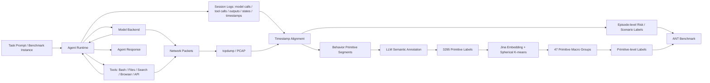

> 面向读者：网络安全、加密流量分析、LLM Agent 安全方向的博士生/硕士生，以及希望快速理解 Agent 流量侧信道审计的跨领域研究者。

---

### 开头：论文基本信息

**论文题目**：*ANT: A Multi-Granularity Network Traffic Dataset and Benchmark for Agents Behavior Auditing*  
**作者**：Fan Li, Xiangyu Gao, Zixuan Liu, Tong Li, Chuanpu Fu, Ziqiang Wang, Ke Xu  
**主要单位**：清华大学、中关村实验室、中国人民大学、南洋理工大学。

📅 **发布时间与发表位置**：截至 **2026-10-18**，公开可核查版本为 **2026-10-05 发布的 arXiv 预印本**，编号 **arXiv:2610.06514v1**，主分类为 `cs.AI`（同时出现在 `cs.LG` 检索分类中）。目前没有在论文首页或公开检索结果中看到正式会议/期刊录用信息，因此更准确的说法是“发布于 arXiv”，而不是“正式发表于某会议/期刊”。  
📌 **CCF 等级**：**不适用（N/A）**。CCF 分级针对正式会议/期刊；arXiv 本身不是 CCF 分级 venue。后续如果论文被某个会议/期刊正式录用，应以最终 venue 的 CCF 等级为准。  
🔗 **论文链接**：https://arxiv.org/abs/2610.06514  

✅ **是否开源**：是。论文明确声明发布 **ANT 数据集、数据采集代码和 benchmark suite**。  
🔗 **数据与代码**：https://anonymous.4open.science/r/ant-main-suite-7BC0/  
📜 **许可证**：代码采用 **GPLv3**；作者贡献的 ANT 数据（网络流量、脱敏后的执行日志、元数据和标注）采用 **CC BY 4.0**。这意味着这篇论文不仅给出一个 benchmark 数字，更重要的是提供了可进一步研究 Agent 流量侧信道的基础设施。

---

## 1. 摘要 (Abstract) 与核心贡献 (Core Contribution)

### 一句话总结

**ANT 的核心目标，是回答“在完全看不到加密 payload 的情况下，仅凭 Agent 执行产生的网络流量，究竟能在多大程度上推断它在做什么、属于什么场景、甚至是否具有恶意风险？”；作者通过同步采集 Agent 执行日志与 PCAP，并构造风险—场景—行为原语三层标签体系，首次把这个问题系统化成一个多粒度 benchmark。**

### 贡献列表 (Contribution List)

- **提出 ANT 多粒度 Agent 网络流量数据集**：包含 **3,114 个执行 episode、20 个任务、5 类场景、659 个不同 task instance、276,417 条双向 flow、104.07 GB 流量、40,049 个 behavior primitive segment**，并将细粒度原语归并为 **47 个 primitive macro groups**。这不是传统“应用/网站识别”数据集，而是把 Agent 的语义执行过程和网络流量时间轴对齐。
- **建立三层 Agent 行为审计 benchmark**：分别评估 **Risk Identification（风险识别）**、**Scenario Recognition（场景识别）** 与 **Behavior Primitive Classification（行为原语分类）**，并覆盖 13 个典型加密流量分类/网站指纹基线，包括 CNN、Transformer、Mamba、对比学习和多标签流量模型。
- **通过实验揭示“流量可见性”的边界**：直接产生明显网络交互的行为（如扫描、SQL 注入、Web penetration）更容易从流量识别；而“恶意代码生成”“sandbox evasion”这类主要差异存在于**语义意图/内容**中的任务，即使整体准确率看起来很高，恶意类召回仍可能很差。论文还进一步证明：**model-call 流量和行为原语的顺序结构都包含可用的场景信号，但现有模型没有充分利用。**

---

## 2. 引言 (Introduction)：问题背景与研究动机

### 问题定义 (Problem Definition)

论文研究的是一个典型的**加密流量侧信道行为审计问题**。设一个 LLM Agent 在执行任务时不断进行：模型调用 → 工具选择 → 外部服务访问 → 读取结果 → 再次推理。TLS 等加密机制会隐藏真正的 prompt、response 和网页内容，但网络侧依然能够观察到：

- 数据包大小与方向；
- 到达时间、inter-arrival time 与 burst 结构；
- flow 持续时间、包数、流量大小；
- DNS、模型后端连接、网页下载等不同通信模式；
- 多条 flow 在时间上的组合与先后关系。

因此，论文真正研究的映射可以写成：

$$
\text{Observable Network Traffic} \rightarrow \{\text{Risk},\ \text{Scenario},\ \text{Behavior Primitive}\}.
$$

这里的三个输出层次分别对应：

1. **Risk level**：这次 Agent 执行是否属于恶意/滥用；
2. **Scenario level**：它在做代码工程、通用问答、科学证据分析、交互式应用操作，还是网络安全滥用；
3. **Primitive level**：在某一个局部时间段，它究竟是在 search、browser fetch、API query、code creation、SQL injection、file reading，还是其他原子化执行动作。

这件事在工业界非常重要：企业希望知道“公司网络中的 Agent 正在干什么”，但又不希望、甚至不允许直接读取用户 prompt、模型回复或加密 payload。ANT 探索的是一个更温和但也更棘手的治理路线：**不看内容，只看通信行为。**

### 现有方法的局限 (Limitations of Prior Work)

第一类工作是传统的**加密流量分类/网站指纹**。这类数据集通常把一个流量 trace 标成某个网站、App、协议或攻击类别，例如 VPN/non-VPN、网站 fingerprinting、移动 App 分类等。它们擅长回答“这是谁的流量”，却没有 Agent 特有的**模型—工具—环境闭环**，更没有“某一时间段对应 Agent 正在执行哪一步”的阶段标签。也就是说，传统数据集缺的是**执行语义**。

第二类是 LLM 加密流量隐私泄露工作，例如利用 token 长度、时间模式恢复 prompt/response 或对话内容。这类研究说明“加密不等于完全无信息”，但目标通常是**内容恢复**，并不系统评估 Agent 的风险、任务场景和局部操作阶段。

论文还特别提到 AgentPrint：它已经开始研究 Agent/粗粒度 activity fingerprint，但依然缺少统一的 **risk + scenario + behavior primitive** 联合标注。于是现有研究之间缺一个公共问题定义：到底能从流量恢复 Agent 行为到什么粒度？

### 本文思路 (Overall Idea)

作者的切入点非常直接：**如果我们能同时记录 Agent 的“真实执行轨迹”和“网络流量时间轴”，就可以把语义事件对齐到 PCAP，并构造真正面向 Agent 行为审计的数据集。**

论文 Figure 1 给了最直观的动机：一个问答任务依次经历 `prelude → Task init → WebSearch → WebFetch → WebSearch → Answer synthesis`。上方是模型调用与工具事件，下方是网络流。可以看到不同 primitive 对应不同流量构成：WebSearch 主要体现为与模型后端通信，而 WebFetch 会明显引入 DNS 和网页内容下载。**这说明“Agent 在做什么”并不完全被加密抹掉，它会通过通信结构留下行为指纹。**

因此 ANT 的整体研究逻辑是：

$$
\text{同步采集} \rightarrow \text{语义分段与标注} \rightarrow \text{原语归并} \rightarrow \text{三粒度 benchmark} \rightarrow \text{分析可识别与不可识别的行为边界}.
$$

---

## 3. 方法论深度解析 (In-depth Methodological Analysis)

### 3.1 整体架构 (Overall Architecture)

这篇论文不是提出一个新的分类神经网络，而是提出一套**“数据构建 + 语义对齐 + benchmark”系统方法**。因此最重要的“整体架构图”是论文 **Figure 3（p.5）** 的数据采集系统。

可以把 Figure 3 重构为下面的逻辑链：

#### 数据如何流动？

1. **输入任务**：每个 task instance 来自公开 benchmark 或安全测试平台；
2. **Agent 执行**：Agent 调用 LLM backend，并使用搜索、Shell、浏览器、文件、API 等工具；
3. **双通道观测**：一边记录 session log（模型调用、工具调用、输出、状态和时间戳），另一边用 `tcpdump` 抓取进出网络的全部 packet；
4. **时间对齐**：用日志中的 primitive 起始时间切割 PCAP；
5. **语义标注**：根据对齐后的 Agent 日志为每段流量赋予一个局部行为语义；
6. **宏组归并**：将大量自然语言 primitive label 嵌入语义空间后聚类成 47 类；
7. **多粒度任务**：episode 层做风险/场景识别，segment 层做 primitive 分类。

#### 宏观设计的核心思想

传统流量数据集的语义通常只有一层，例如“这是 YouTube”“这是某网站”“这是恶意流量”。ANT 的关键改变是把 Agent 看成一个**有内部阶段结构的长时序程序**：

$$
\text{Episode} = (z_1,z_2,\ldots,z_T),
$$

其中每个 $z_t$ 是一个 behavior primitive。这样一来，episode 不再是一个不可分割的黑盒 trace，而是一个由“行为阶段”构成的序列。这个表示非常重要，因为论文后面的实验恰恰说明：**很多高层场景不能只靠单条 flow 判断，而要利用多个阶段以及阶段之间的顺序关系。**

---

### 3.2 核心组件/模块拆解 (Core Component Breakdown)

#### 3.2.1 模块一：多场景、多 Agent 的同步流量采集系统

**输入和输出 (Input & Output)**  
输入是 20 个 Agent 执行任务中的具体 task instance；输出包括完整 PCAP、Agent session log、任务元数据和 episode 标签。

论文定义了 5 个场景（Table 1、Appendix Table 4）：

| 场景 | 典型任务 | Episodes | 流量规模 |
|---|---|---:|---:|
| Computational Artifact Engineering | SWE-bench、DS-1000、数据分析 | 516 | 33.41 GB |
| General Knowledge QA | GAIA、Natural Questions、HotpotQA、ASQA 等 | 1,014 | 16.55 GB |
| Scientific Evidence Assessment | QASPER、SciFact、PubMedQA、ScholarQA 等 | 853 | 8.47 GB |
| Interactive Application Operation | WebArena、MultiWOZ 改造环境 | 315 | 14.77 GB |
| Cybersecurity Misuse | 攻击代码生成、Sandbox Evasion、OWASP Juice Shop | 416 | 30.87 GB |

总计 **3,114 episodes、104.07 GB、276,417 bidirectional flows**。

作者还覆盖了多种 Agent/模型组合（Appendix Table 5）：Claude Code + DeepSeek/MiMo/Sonnet、Codex CLI + GPT-5.4、Qwen Code + Qwen3.6-Plus。Figure 2 中 DeepSeek 还按国内/海外采集环境分开统计，因此图中视觉上出现 6 个扇区，但本质上是 5 个 agent+backend 配置加上一个地理采集设置维度。

**内部机理 (Internal Mechanism)**  
所有任务执行过程中同时启用两个观测面：

- **语义面**：记录 model call、tool invocation、tool output、session state 及时间戳；
- **网络面**：`tcpdump` 捕获所有 inbound/outbound packet，保留 PCAP。

每个 task instance 在独立的 virtual network namespace 中运行，减少并发干扰；有状态 benign 交互尽量运行在本地模拟服务；攻击任务限制在隔离 Docker 中。作者避免使用真实账号、隐私通信和 PII，这一点对于一个安全流量数据集非常重要。

**设计动机 (Design Rationale)**  
网络流量本身没有“语义真值”。如果只采 PCAP，就只能猜测哪个 burst 对应哪个 Agent 动作。同步日志解决了 ground truth 问题：**日志负责告诉你“Agent 此刻想做什么”，PCAP 负责告诉你“这件事在网络层长什么样”。** 这种双通道同步，是 ANT 相较普通网络流量数据集最核心的基础设施创新。

---

#### 3.2.2 模块二：Behavior Primitive 分段、语义标注与宏组聚类

这是 ANT 最有研究味道的部分，因为它把“复杂 Agent 长轨迹”压缩为一组可学习、可统计的局部行为单元。

**输入和输出 (Input & Output)**  
输入是带时间戳的 session log + PCAP；输出是 **40,049 个 behavior primitive segments**，以及去除表述差异后的 **47 个 primitive macro groups**。

**内部机理 (Internal Mechanism)**  
作者先按日志中的每个 behavior primitive 起始时间作为边界，对 packet 进行切分。值得注意的是，如果某个 transport flow 跨越 primitive 边界，作者不是把整条 flow 粗暴归到某一侧，而是**逐 packet 分配到对应 segment**。第一个 primitive 之前的网络流量被保留为一个特殊的 `prelude` segment。

然后，作者使用 **DeepSeek-v4-pro** 读取已对齐的 session log 信息，为每个局部阶段生成高层意图标签。Appendix B.1 给出了完整 annotation prompt，明确要求模型不要靠关键词，而要结合 message content、tool calls、tool results 总结局部意图。例如：

- `paper_search`
- `browser_navigation`
- `code_debugging`
- `sql_injection`
- `answer_synthesis`

最终得到 **3,295 个不同的自然语言 primitive labels**。直接用 3,295 类做监督学习显然过于稀疏，因此作者使用 **Jina Embeddings v5** 将标签编码到语义空间，并用 spherical K-means + cosine K-means++ 聚类。

最终选择：

$$
K=47.
$$

Figure 4 展示 47 个 cluster；Appendix Table 7 给出了 canonical label 与 train/val/test 数量，例如 `search`、`browser_fetch`、`code_creation`、`api_query`、`sql_injection` 等。

**设计动机 (Design Rationale)**  
为什么不一开始就人工定义 47 个类别？因为 Agent 的局部行为具有强开放性。如果预先规定 taxonomy，很容易漏掉新工具、新动作和跨任务行为。作者采用“先自由语义标注，再聚类归并”的方式，实际上是在平衡：

$$
\text{开放语义覆盖能力} \quad \leftrightarrow \quad \text{可训练的类别规模}.
$$

这很合理，但也埋下一个后文需要批判的问题：Appendix Figure 11 显示，在 $K=47$ 时 cosine silhouette 约 **0.157**、seed stability 约 **0.51 ARI**。这说明 47 类并不是一个特别“天然、边界清晰”的聚类结构；不少 primitive 在语义空间中本来就相互接近。这与后面 primitive 分类中 `search / browser_fetch / api_query` 大量互相混淆，其实是同一个根源。

---

#### 3.2.3 模块三：Risk—Scenario—Primitive 三粒度 Benchmark

**输入和输出 (Input & Output)**  
模型输入只使用 packet header 和 side-channel information，例如 packet direction、timing、length；IP 地址等 identifying fields 被 mask，以减少 shortcut learning。输出则根据任务分为三种：

| 粒度 | 输入单元 | 输出空间 | 目标 |
|---|---|---|---|
| Risk | Episode | benign / malicious | Agent 滥用风险审计 |
| Scenario | Episode | 5 类场景 | 合规与使用场景识别 |
| Primitive | Segment | 47 macro groups | 局部行为审计/取证 |

**内部机理 (Internal Mechanism)**  
论文引入 13 个 baseline，分成两类：

- **Encrypted Traffic Classification**：FlowLens、YaTC、NetMamba、TFusion、TrafficFormer；
- **Website Fingerprinting**：DF、AWF、TikTok、Var-CNN、NetCLR、TMWF、ARES、BAPM。

前一类主要在 flow 层建模，因此 episode-level 预测需要把多条 flow 的结果聚合；后一类本身更偏 trace/episode 级建模。作者在 validation set 上从 mean soft、majority vote、confidence weighted mean、max confidence 等 aggregation 策略中选择最优者。

**设计动机 (Design Rationale)**  
作者没有先提出“自己的强模型”再构建 benchmark，而是刻意让已有模型来回答一个更基础的问题：**目前成熟的流量分类技术，天然能够恢复多少 Agent 行为语义？** 这让论文的价值更像一个“测量研究（measurement study）”：它不仅给出哪个模型最好，更重要的是指出**信息究竟存在于哪里、现有方法又在哪里失效**。

---

### 3.3 关键公式与算法 (Key Equations and Algorithms)

#### 公式一：用 Maximum Mean Discrepancy 衡量“同一场景中的 primitive 分布是否更相似”

作者不仅构造了 primitive 标签，还进一步验证：这些 primitive 的使用分布是否真的与场景语义相关。对 episode $i$ 和 $j$ 的 primitive embedding 分布 $\mu_i,\mu_j$，论文定义 MMD：

$$
d_k(\mu_i,\mu_j)=
\left\|
\int k(x,\cdot)d\mu_i(x)
-
\int k(x,\cdot)d\mu_j(x)
\right\|_{\mathcal H_k}.
$$

其中：

- $\mu_i$：第 $i$ 个 episode 中所有 primitive embedding 构成的经验分布；
- $x$：某个 primitive 的 1024 维 unit-normalized embedding；
- $k(x,y)$：Gaussian kernel；
- $\mathcal H_k$：这个 kernel 对应的 reproducing kernel Hilbert space；
- $d_k$ 越小，表示两个 episode 的 primitive 语义组成越相似。

接着定义 cohesion gain：

$$
G_d = 1-\frac{D_{\text{within}}}{D_{\text{between}}},
$$

其中 $D_{\text{within}}$ 是**同一场景、不同任务之间**的平均距离，$D_{\text{between}}$ 是**不同场景任务之间**的平均距离。

**公式的目标 (Objective)**  
它要回答的不是“分类准确率多高”，而是一个更基础的统计问题：**场景这个标签是否真的对应不同的 primitive 语义分布？**

**公式的直觉 (Intuition)**  
如果“Scientific Evidence Assessment”内部不同任务都共享搜索论文、读取证据、验证、综合回答等 primitive，那么它们之间的距离应该小于它们与“代码工程”或“网络攻击”的距离。若成立，$D_{within}<D_{between}$，于是 $G_d>0$。

论文得到：

- Primitive embedding MMD cohesion gain：**15.46%**；
- Primitive macro-group Hellinger cohesion gain：**14.79%**；
- Holm 校正后分别达到显著性水平（Table 8）。

这说明作者定义的“场景”并非完全人为拍脑袋，它在行为原语的分布结构中确实存在统计信号。

---

#### 公式二：去掉“组成”影响后，验证 primitive 的顺序本身是否有信息

一个更有意思的问题是：如果两个 episode 用到的 primitive 集合完全一样，只是顺序不同，顺序还是否携带场景信息？

对 primitive macro group 的相邻转移，论文定义：

$$
J_i(a,b)=\frac{1}{n_i-1}\sum_{t=1}^{n_i-1}\mathbf 1\{z_{it}=a,z_{i,t+1}=b\}.
$$

这里 $J_i(a,b)$ 是 episode $i$ 中从 group $a$ 转移到 group $b$ 的实际相邻频率。若只固定每类 primitive 的个数、然后随机打乱顺序，那么理论上的期望转移概率为：

$$
\frac{n_{ia}\left(n_{ib}-\mathbf 1\{a=b\}\right)}{n_i(n_i-1)}.
$$

因此作者构造**transition residual**：

$$
C_i(a,b)=J_i(a,b)-
\frac{n_{ia}\left(n_{ib}-\mathbf 1\{a=b\}\right)}{n_i(n_i-1)}.
$$

**公式的目标 (Objective)**  
剥离“某类 primitive 出现了多少次”这一 composition effect，只保留**真实执行顺序相对随机排列多出来的结构**。

**各部分的含义 (Meaning of Terms)**  
- $n_i$：episode 长度；
- $n_{ia}$：group $a$ 在 episode $i$ 中出现次数；
- $J_i(a,b)$：观测到的真实相邻转移；
- 后一项：同样的 primitive multiset 在随机排列下应该出现的转移；
- $C_i(a,b)$：真正由 Agent 工作流组织方式产生的“额外转移偏好”。

**公式的直觉 (Intuition)**  
假设两个任务都出现 `search`、`browser_fetch`、`answer_synthesis`。只看出现次数，它们可能完全一样；但实际 Agent 往往遵循：

$$
\text{search} \rightarrow \text{fetch} \rightarrow \text{search} \rightarrow \text{synthesis},
$$

而不是随机乱序。这个“顺序语法”很可能比单纯词袋式的 primitive histogram 更接近 Agent 的真实工作流。

论文通过随机置换检验发现：

- Directed area 的 observed cohesion 比随机顺序平均值高 **5.77 个百分点**；
- Transition residual 高 **5.24 个百分点**；
- 即使固定 role position 后再做 permutation，额外顺序信号仍显著（Table 10）。

这实际上给后续模型设计提出了非常明确的方向：**Agent 流量审计不应只做 flow-level/episode-level pooling，而应显式建模“行为阶段序列”。**

> 🔍 一个很值得注意的附加结果：论文 Eq. (9) 的信息分解表明，primitive macro-group composition 的总变化中，**34.86% 与 scenario 相关、22.84% 来自 scenario 内 task 差异、42.30% 来自 task 内 episode 差异**（Table 9）。这说明“场景”确实重要，但 episode 自身随机性依然是最大的单项来源，因此想做稳定部署不能只依赖模板式 fingerprint。

---

## 4. 实验设计与结果分析 (Experimental Design and Results Analysis)

### 实验设置 (Experimental Setup)

#### 数据划分

作者在**每个 task 内随机划分 episode**为固定 train/validation/test；primitive segment 继承其 source episode 的 split，从而避免同一个 episode 的 segment 跨集合泄漏。

Episode test set 一共有 **209 个 episode**：

- benign：189；
- malicious：20；
- 五个场景测试数量依次为：35、72、60、22、20。

Primitive benchmark 实际评估 **2,101 个 test segments**、47 类 macro groups。训练时如果某个 primitive 类少于 200 个样本，则通过 replacement sampling 上采样到 200；validation/test 保持原始分布。

#### 评价指标 (Metrics)

- **Risk**：Accuracy、F1、FPR、Recall；
- **Scenario**：Episode-level Accuracy、per-class Recall、confusion matrix；
- **Primitive**：overall Accuracy、per-group Recall。

这里 Risk 的 Accuracy 必须谨慎看，因为测试集是 189:20 的明显类别不平衡；论文也正是通过 F1/Recall/FPR 揭示“高 accuracy 掩盖低 malicious recall”的问题。

#### Baselines

13 个模型覆盖了从统计特征到深度序列建模的主要路线：FlowLens、YaTC、NetMamba、TFusion、TrafficFormer、DF、AWF、TikTok、Var-CNN、NetCLR、TMWF、ARES、BAPM。

---

### 主实验结果 (Main Results)

#### 4.2.1 风险识别：高 Accuracy 不代表真的能抓到恶意 Agent

论文 **Table 3** 是全文最值得仔细读的一张表。

所有 13 个 baseline 的 Accuracy 都超过 0.90，看起来似乎“问题已经解决”。但恶意样本只有 20 个，因此一个只偏向预测 benign 的模型也能获得很高 Accuracy。看 Recall 后结论完全不同：超过一半模型的恶意类 Recall 低于 0.5。

例如：

- FlowLens：Accuracy **0.923**，但 Recall 只有 **0.200**；
- AWF：Accuracy **0.904**，Recall **0.150**；
- YaTC / NetMamba：Accuracy 都是 **0.928**，Recall **0.250**；
- TikTok：Accuracy **0.981**，F1 **0.905**，Recall **0.950**，是整体表现最均衡的 baseline 之一。

**Figure 5** 进一步把 malicious 拆成三个任务：Malicious Code Generation、Sandbox Evasion、Web Penetration。结果非常关键：YaTC、NetMamba、TFusion、TrafficFormer 对 Web Penetration 的检测接近 1.0，但对前两个任务可以直接降到 **0.0**。

为什么？

Web Penetration 会产生扫描、SQL injection、XSS、API probing 等直接对外网络行为，这些动作在 packet timing、流量方向、目标交互模式上会形成明显 signature。而 Malicious Code Generation 与 Sandbox Evasion 很大一部分“恶意性”藏在**代码内容和执行意图**里；从外部看，它们可能和正常代码生成一样，仍然主要是模型调用、Shell、调试和反复修改。

因此这组结果强烈验证了论文的核心假设，同时也给出了边界：

> **网络流量能够很好识别“行为形式不同”的恶意活动，却很难识别“行为形式相似、只有语义意图不同”的恶意活动。**

这比简单说“流量能识别风险”要严谨得多。

---

#### 4.2.2 场景识别：部分语义可恢复，但“语义相近场景”仍然难

在 5 类场景识别中，13 个 baseline 的 Accuracy 范围为 **0.431–0.727**，最好的 **NetMamba = 0.727**。这个数字说明网络流量确实包含场景信息，但距离“可靠审计”还很远。

最典型的错误来自 **Scientific Evidence Assessment ↔ General Knowledge QA**。根据 **Figure 7** 汇总的混淆：

- 35.1% 的 Evidence Assessment 被预测成 Knowledge QA；
- 22.8% 的 Knowledge QA 被预测成 Evidence Assessment。

从 Agent 工作流看这非常合理：二者都大量执行 search、fetch、推理、答案合成。它们的 model backend traffic share 也接近（57.44% vs. 58.60%）。虽然 Evidence Assessment 平均 flow duration 更长、packet 更多、平均 packet length 更低、inbound payload share 更高，但现有模型没有稳定抓住这些细微差异。

这个结果验证了一个重要观点：**场景不是由单一 flow signature 决定，而是由多阶段、长时依赖的“工作流形状”决定。** NetMamba 作为长序列 state-space model 表现最好，也与这个解释方向一致，但论文还没有证明“长程建模本身”就是因果原因。

---

#### 4.2.3 Behavior Primitive：局部动作确实可识别，但长尾问题非常严重

在 47 类 primitive 分类中，8 个 website fingerprinting baseline 的 overall Accuracy 只有 **0.355–0.462**，最好的是 DF（**0.462**）。看起来并不高，但真正的问题不是平均 accuracy，而是类别间严重不均衡。

**Figure 10** 显示，同一个模型在不同 primitive 上 Recall 可以从 **0.0 到 0.9**。测试集中最常见的前 10 类占 **72.44%** 的样本，却贡献每个模型 **91.34%–96.09%** 的正确预测。

典型混淆包括：

- 204 个 `browser_fetch` 中有 37 个被预测成 `search`；
- 527 个 `search` 中有 38 个被预测成 `api_query`，35 个被预测成 `browser_fetch`。

这说明流量中确实存在局部行为信号，但很多 semantic-neighbor primitive 在网络层的生成机制也很接近。单纯增加分类器容量并不一定能解决；更可能需要**上下文、前后 primitive、目标服务类型、跨 flow 关系**共同参与判断。

---

### 消融实验 (Ablation Studies)

这篇论文的消融很有价值，因为它没有只问“模型分数多少”，而是直接问：**场景信息究竟藏在流量的哪一部分？**

#### 消融一：Model-call traffic 到底重要不重要？——Figure 8

作者对 8 个 website fingerprinting baseline 分别用三种流量重新训练：

1. Full traffic；
2. Model-call only；
3. Without model-call。

相对于 Full traffic：

- **Model-call only 平均 Accuracy 提升 5.56 个百分点**；
- **去掉 model-call 平均下降 4.31 个百分点**；
- 即便完全没有 model-call，剩余流量仍可达到 **0.392–0.627** 的 Accuracy。

这个结果很有意思。它不是简单说明“model call 最有用”，而说明：

> **Model-call 流量包含非常强的场景信号，而且现有模型在它被单独隔离出来时反而更容易学习；其他 tool/service 流量虽然也有信息，但混在一起时可能表现为噪声或异质模式。**

从模型设计角度，这强烈暗示应该做**traffic-type-aware representation**，而不是把所有 packet 作为一个无差别长序列。

#### 消融二：代表性 behavior primitive 是否真的支撑场景判断？——Figure 9

作者先根据频率和 primitive embedding 与 task semantic center 的 cosine similarity，为每个 episode 选择“代表性 primitive”。然后清除一段流量：

- 清除 representative segment：平均 Accuracy **下降 6.95 pp**；
- 清除随机 non-representative segment：平均只 **下降 3.77 pp**。

这说明与任务语义高度对齐的局部阶段，比普通阶段更能驱动场景预测。

**哪个部分贡献最大？** 不能简单把 6.95 pp 与 4.31 pp 直接横向排序，因为两种消融改变的对象、训练方式和 baseline 子集并不完全相同。但可以得出相对稳健的结论：

- **全局层面**：model-call traffic 是最稳定、最强的一类场景信号；
- **局部层面**：task-aligned representative primitive 比随机 primitive 更重要；
- **序列层面**：真实 primitive order 还提供了 composition 之外的额外信息。

换句话说，真正理想的 Agent 流量模型应该同时做：**traffic source decomposition + primitive localization + temporal sequence modeling**。

---

### 具体实现的细节

#### 运行环境

论文实验运行在 Linux server：

- 2 × Intel Xeon Gold 6348；
- 1 TiB memory；
- 5 × NVIDIA A100 80GB；
- Python 3.12.4；
- PyTorch 2.11.0；
- CUDA 12.8。

#### 关键模型配置（Appendix Table 11）

| Baseline | 主要输入 | 关键实现细节 |
|---|---|---|
| FlowLens | 4 个 flow statistics | packet count、total bytes、median inter-arrival、flow duration；RF 100 trees |
| YaTC | 40×40 bytes | 预训练 checkpoint，AdamW，WD=0.05，layer-wise LR decay 0.75，label smoothing 0.1 |
| NetMamba | 40×40 bytes | 预训练 Mamba，Risk/Scenario 使用不同 batch/LR，WD=0.05 |
| TFusion | packet sequence + statistical features | Risk 阶段先 contrastive train encoder，再接 RF；Scenario 冻结 encoder |
| TrafficFormer | 256/320 tokens | Transformer traffic tokenization；Risk/Scenario 分别设定 dropout/LR |
| DF | direction sequence / 5000 | Adamax，30 epochs |
| TikTok | signed relative timestamps / 5000 | 显式使用 timing + direction 信息 |
| Var-CNN | direction + inter-arrival / 5000 | parallel convolutional branches |
| NetCLR | direction / 5000 | contrastive representation learning |
| TMWF | direction / 30720 | 适合 mixed/multi-tab trace |
| ARES | 8×8000 MTAF | 前 10,000 packets，用 20 ms bin 转换为 8-channel temporal features |
| BAPM | direction / 8500 | block-level attention |

Website Fingerprinting 系列统一采用 cross-entropy 与固定学习率，checkpoint 根据 validation accuracy 选择。primitive training 中，小于 200 个 segment 的类别被随机有放回上采样到 200。

Episode-level 的 encrypted traffic classifiers 需要把 flow prediction 聚合成 episode prediction。Scenario 中主要使用 flow probability mean 后 argmax；Risk 中 FlowLens/YaTC 使用同类聚合，而 NetMamba/TFusion/TrafficFormer 最终使用 majority voting。

---

## 5. 讨论与思考 (Discussion and Reflection)

### 优点与创新点 (Strengths & Innovations)

**第一，问题定义非常及时，而且不是“为了模型而造任务”。** 过去很多 Agent security 工作关注 prompt injection、tool misuse、sandbox escape，但组织网络真正能稳定获得的信号往往是流量。ANT 把“企业能看到什么”与“我们想审计什么”连接起来，是一个现实约束驱动的问题。

**第二，数据集最强的地方不是体量，而是时间同步的多粒度 ground truth。** Figure 3 的日志—PCAP 双通道采集，让同一 episode 同时具备 episode-level 和 segment-level 标签。这使研究者可以同时研究分类、分段、序列建模、因果定位、取证解释，远比单一 label 的流量数据集可扩展。

**第三，实验不是只报 SOTA，而是有明确的“信息定位”意识。** Figure 8 的 traffic scope ablation、Figure 9 的 segment clearing，以及 Appendix C 对 primitive distribution/order 的统计检验，都在回答“为什么可识别”“信息来自哪里”。对 benchmark 论文来说，这比把更多网络模型堆上去更有科学价值。

**第四，论文对负面结果相对诚实。** 它没有因为所有 baseline Accuracy 都超过 0.9 就宣称 risk auditing 已经解决，而是主动指出 malicious recall 很低，并把困难归因于“恶意意图没有明显改变网络行为”。这使结论边界比较可信。

---

### 局限性与可商榷之处 (Limitations & Debatable Points)

#### 1. Episode 随机划分可能高估对“新任务实例/新配置”的泛化能力

论文写的是“within each task 随机划分 episodes”。ANT 有 **659 个 distinct task instances，却有 3,114 episodes**，意味着同一个 task instance 很可能在多个 agent/model/configuration 下重复执行。如果相同或高度相似的 task instance 出现在 train 和 test，模型可能部分学习到任务模板、访问站点集合、执行长度等 fingerprint，而不是抽象的场景语义。

这不是论文已证明存在的数据泄漏，而是当前 split 设计留下的**泛化风险**。更严格的评估至少应该补充：

- task-instance-disjoint split；
- leave-one-task-out；
- leave-one-agent/backend-out；
- leave-one-network-location-out。

只有这些结果稳定，才能说明模型真正学到了“Agent 行为模式”，而不是某个 benchmark 或 backend 的 fingerprint。

#### 2. Model-call only 明显优于 full traffic，既是发现，也可能是 confound 警报

Figure 8 中 model-call-only 平均提升 5.56 pp，是全文最有启发性的结果之一，但也应该更谨慎解释。因为 model-call traffic 可能同时编码：

- backend/model identity；
- token generation / response length pattern；
- prompt/task complexity；
- 重试、reasoning turn 数；
- 具体 Agent harness 的调用协议。

如果不同 scenario 在 agent/backend 配置上没有严格平衡，那么 scenario classifier 有可能利用“配置差异”而非“行为语义”。论文给了全局 Figure 2，但没有在主文中系统报告**每个 scenario × configuration 的分布平衡**，也没有做 leave-one-backend-out。对于一个声称研究“场景语义”的 benchmark，这应该是下一版最优先的控制实验。

#### 3. 恶意测试集只有 20 个 episode，Risk 结论的统计不确定性很大

209 个 test episode 中只有 20 个 malicious，因此 overall malicious recall 每错/对一个样本就改变 **0.05**。Figure 5 再细分到三种攻击任务后，每类样本更少，0.12、0.17 这种 recall 步长也暗示每个子任务可能只有个位数测试样本。

所以 Table 3 很适合展示“问题存在”，但不适合把 0.90 与 0.95 这类差异解读成稳定排名。更理想的报告应该增加：bootstrap confidence interval、PR-AUC、balanced accuracy、MCC、calibration，以及更大规模的 malicious test set。

#### 4. Primitive taxonomy 的边界并不十分稳定

作者用 AI 标注 + embedding clustering 得到 47 类，但 Appendix Figure 11 的 cosine silhouette 约 **0.157**，seed stability 约 **0.51 ARI**。这意味着 cluster 之间存在显著重叠。2,000 样本 spot check “没有 substantial errors”能排除明显错误，却不能替代真正的 annotation reliability 评估。

更严谨的版本可以加入：

- 双人独立人工标注；
- inter-annotator agreement；
- hierarchical taxonomy；
- multi-label primitive，而非强制每段只属于一个 macro group。

事实上 `search`、`browser_fetch`、`api_query` 在语义和网络行为上本来就可能连续，而不是天然互斥的离散类别。

#### 5. 用“任务上下文”辅助 primitive annotation，可能把部分 scenario 语义提前写进标签

Appendix B.1 的 prompt 要求“label each message independently while using surrounding task context”。这对生成高质量语义标签很合理，但随后作者又用 primitive embedding distribution 去证明 scenario cohesion。这里存在一个值得区分的逻辑层次：

- primitive label 的语义相关性，一部分来自真实执行行为；
- 另一部分也可能来自 annotation model 读取了 surrounding task context。

因此 Appendix C 的 cohesion analysis 更准确地说明“**作者构造出的 primitive semantics 与 scenario 有统计结构**”，而不能单独证明“**原始网络流量天然包含同等强度的 scenario structure**”。后者仍要依赖 Figure 8/9 与分类实验来验证。

#### 6. Figure 9 的 segment clearing 还可能混入“流量体量”因素

代表性 primitive 被清除后 Accuracy 降得更多，作者解释为“task-aligned local behavior 更重要”。这个解释是合理的，但如果 representative segment 往往更长、包更多或更靠近模型调用密集阶段，那么清除它自然会移除更多信息量。

更强的对照应该是：**长度匹配、packet-count 匹配、traffic-volume 匹配的非代表性 segment clearing**。这样才能更干净地证明“语义代表性”本身，而不是 segment size，导致性能下降。

#### 7. 受控环境与真实企业网络之间仍有 domain gap

论文自己承认部分数据在 controlled local environment 中采集。真实网络还会加入：VPN、proxy、CDN、缓存、丢包、带宽变化、多用户并发、后台更新、HTTP/3/QUIC、企业安全网关等复杂因素。这些都会改变 timing 与 burst signature。

因此 ANT 更适合作为**第一代可控 benchmark**，而不是直接等价于真实企业部署性能。真正上线需要 cross-network / cross-time / cross-organization domain adaptation。

#### 8. 双重用途问题不可忽视

从治理角度，流量侧行为识别有助于企业审计；从攻击者角度，同样技术也可以用来推断用户正在让 Agent 做什么。ANT 实际上同时是一个**Agent privacy leakage benchmark**。因此未来不仅应该研究“识别更准”，也应该研究如何通过 padding、traffic shaping、batching、proxy multiplexing 等方式减少行为 fingerprint。

---

### 未来工作与启发 (Future Work & Inspirations)

如果把 ANT 看成一个起点，而不是终点，我认为最值得做的下一步有以下几条。

#### 方向一：从“episode classifier”升级为层次化 Agent 行为序列模型

ANT 已经证明：primitive composition 与 primitive order 都含有 scenario 信息。因此一个自然的新模型是：

$$
\text{Packets} \rightarrow \text{Flow Encoder} \rightarrow \text{Primitive/Stage Encoder} \rightarrow \text{Episode Sequence Model} \rightarrow \text{Risk/Scenario}.
$$

其中 stage 可以是显式检测，也可以是 latent segmentation。相比简单 pooling，这种层次结构更符合 Agent 的真实执行逻辑。

#### 方向二：做真正的 configuration-invariant / backend-invariant auditing

下一步 benchmark 应该重点测试：训练在 Claude Code + DeepSeek，能否泛化到 Codex + GPT、Qwen Code，甚至未来完全没见过的新 Agent harness。技术上可以使用 domain adversarial training、contrastive invariance、style/content disentanglement，尽量把“backend fingerprint”与“behavior fingerprint”分开。

#### 方向三：解决 rare primitive 与 open-set behavior

目前 primitive 分类主要被头部类别驱动。实际安全审计里恰恰是罕见行为最重要。可以考虑：

- metric learning / prototype learning；
- hierarchical classification；
- few-shot / zero-shot primitive recognition；
- open-set / novelty detection；
- 以 sequence context 帮助长尾 primitive 判别。

#### 方向四：从“使用日志做分段”走向“纯流量自监督分段”

当前 ANT 的 primitive boundary 来自 session log，这是构造 ground truth 的正确方法。但真实企业部署时，网络管理员往往拿不到 Agent 内部日志。因此更实际的问题是：

> **能否只根据流量 burst、连接建立/关闭、DNS、模型调用节奏，自动检测行为阶段边界？**

这可以变成一个 change-point detection / temporal segmentation 问题，然后再对 segment 做语义分类。

#### 方向五：把风险识别从“任务标签”推进到“行为意图 + 结果”

现在 Cybersecurity Misuse 是按任务来源定义风险，容易遇到 benign penetration testing、红队演练、安全研究与真实恶意攻击行为高度相似的问题。后续可以把 risk 分解为：

$$
\text{Capability} + \text{Intent} + \text{Target Authorization} + \text{Observed Consequence}.
$$

仅凭流量可能无法恢复全部维度，但这恰恰可以帮助明确“网络侧审计能做什么、不能做什么”，避免把流量分类器误当成最终安全判决器。

#### 方向六：反过来研究 Agent 流量隐私防御

既然 model-call traffic 能强烈泄漏场景，下一步自然应问：如何让不同任务在网络层“更像”？例如：

- 固定大小 padding；
- 延迟/节奏扰动；
- 多路复用；
- model-call batching；
- 代理层 traffic shaping。

这会形成一个很有价值的隐私—审计 trade-off：

$$
\text{Auditability} \leftrightarrow \text{Behavior Privacy}.
$$

企业可能希望保留“是否恶意”的可审计性，却隐藏具体用户任务；这比简单追求“所有信息都不可推断”更符合实际治理需求。

### 值得继续追问的几个问题

1. **Figure 8 中 model-call-only 为什么比 full traffic 更好？** 是因为非模型流量是噪声，还是因为 backend/model identity 与 scenario 存在潜在相关？
2. **如果用 task-instance-disjoint、leave-one-agent-out split，0.727 的场景准确率还剩多少？** 这将直接决定 ANT 是“任务 fingerprint benchmark”还是“真正的行为语义 benchmark”。
3. **能否在完全没有 session log 的情况下，从 PCAP 自动切出 primitive boundary？** 这是从研究数据集走向企业在线部署的关键一步。
4. **恶意意图与 benign workflow 网络行为几乎相同时，流量审计的理论上限在哪里？** 是否应该与 endpoint telemetry、tool permission log、process trace 做多模态融合？
5. **47 类 primitive 是否应该改为层次化或多标签 taxonomy？** 对 `search / fetch / API query` 这类连续语义，硬单标签分类可能天然不合理。
6. **如何在提高 Agent 行为审计能力的同时保护用户任务隐私？** ANT 很可能既推动检测研究，也推动流量隐私防御研究。

---

**总体评价**：ANT 最值得关注的不是某个 baseline 的最高数字，而是它把“LLM Agent 的网络行为侧信道”第一次系统拆成 **episode 风险、任务场景、局部行为原语** 三个粒度，并通过同步日志、PCAP、统计结构分析和现有流量模型 benchmark，明确展示了一个非常重要的现实：**网络流量能够暴露 Agent 的一部分行为语义，但它更擅长识别“通信行为本身不同”的动作，而不是“通信行为相似、仅意图不同”的语义风险。** 对 Agent 安全研究而言，这既说明了流量审计的潜力，也清楚划出了它不应被过度承诺的边界。
