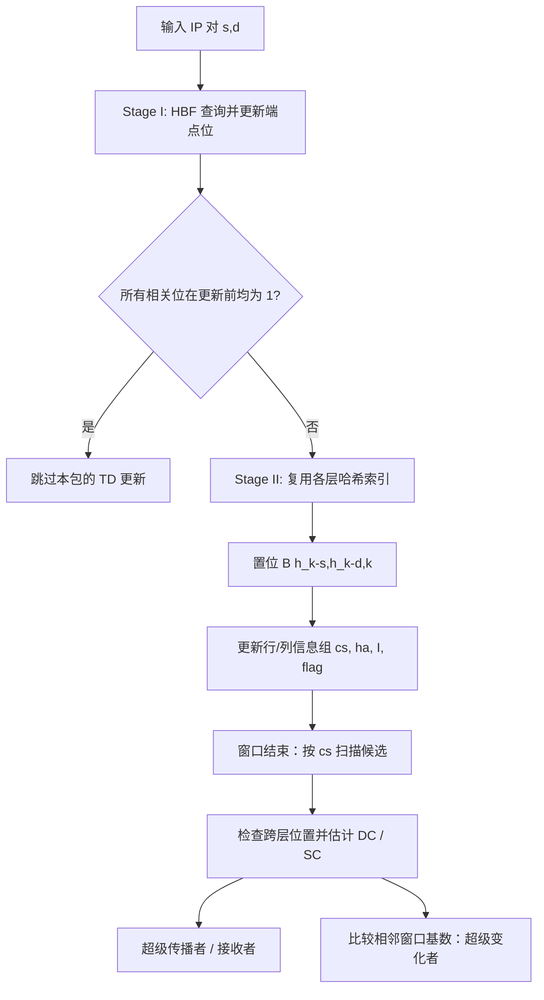

> **论文**：Tuo Zhang *et al.*, **H-TD Sketch: An H-Shaped Sketch for Identifying Multiple Super Hosts**  
> **阅读视角**：网络测量、流式算法、可逆 Sketch 与系统实现  
> **核心问题**：如何在有限高速内存中，同时估计源/目的基数、定位异常 IP，并捕捉相邻周期的基数突变？  
> **证据标记**：下文将 **【论文事实】** 与 **【阅读者分析】** 分开；图号、表号和页码均指原始 26 页 PDF。图像摘自论文，仅作学术阅读与技术解读。

## 📌 发表信息与代码可用性

| 项目 | 核实结果 |
|---|---|
| 正式发表 | **2026 年 11 月 11 日**；收稿 2026-09-27，接收 2026-11-04（原文第 1 页） |
| 期刊与出版方 | **Information**，MDPI；**2026, 17(11), 1133**，属于期刊论文而非会议论文 |
| 论文链接 | [DOI：10.3390/info17111133](https://doi.org/10.3390/info17111133) · [出版社全文](https://www.mdpi.com/2078-2489/17/11/1133) |
| **CCF 级别** | **未列入 CCF 2026 年第七版推荐国际会议和期刊 A/B/C 名录**；因此不是“CCF C 类”，而是**无 CCF 分级**。注意不要与 *Information Sciences* 或 *Information and Computation* 混淆。参考 [CCF 官方目录](https://www.ccf.org.cn/Academic_Evaluation/By_category/) |
| 论文开放获取 | **是**。论文采用 CC BY 开放获取许可 |
| 源代码 | 论文第 5 节及参考文献 [39] 声称公开源代码，地址：[Future-Internet-Research-Lab-TJU/H-TD-Sketch](https://github.com/Future-Internet-Research-Lab-TJU/H-TD-Sketch)。**截至 2026-11-17，公开仓库页面显示 “This repository is empty”**，故目前不能据此下载、运行或验证作者实现。**论文 OA 不等于代码已实际可获得** |

**先给出阅读判断：**这是一项颇有工程设计感的双向基数测量方案，真正值得学习的是“共享位图 + 候选地址保留 + 分层验证”的组合；但其 HBF 的**端点级过滤与地址对级去重之间存在语义差异**，会引出一个可以构造的漏计反例，应成为阅读和复现时的第一验证项。后文会严格区分已报告的实验成绩与尚待证实的正确性假设。

---

## 1. 摘要（Abstract）与核心贡献（Core Contribution）

### 1.1 一句话总结

**作者提出 H-TD Sketch：使用 H 形 Bloom 过滤结构和多层三维共享位图，在一次数据包更新中同时积累源/目的连接基数，并借助信息组直接保留候选 IP，从而识别超级传播者、超级接收者和超级变化者。**

### 1.2 贡献列表（Contribution List）

1. **一个结构同时支持双向基数测量**：以 $r\times c\times d$ 的三维位图容纳源、目的 IP 的映射；读取某个**行**估计源主机的目的基数，读取某个**列**估计目的主机的源基数（图 2、图 5）。
2. **将“估计数值”与“找回地址”合并设计**：每行/列配置保存候选地址 $ha$、累计计数 $cs$、投票量 $I_s/I_d$ 与跨层定位 $flag$ 的信息组，避免仅有 Sketch 数值却无法知道“是哪台主机”的问题（算法 2、图 4）。
3. **围绕高速处理进行协同优化与验证**：HBF 筛除一部分冗余更新，两个阶段复用端点哈希；在 CAIDA 真实流量上比较估计误差、识别精度与时延，并在 Open vSwitch + DPDK 上测量数据包处理率（图 9–19）。

**核心创新判断：**作者并未发明新的基数估计器，基础估计仍是经典的 *linear counting*（零位计数）；其创新重心在**双方向共用的存储布局、候选管理与识别路径的工程协同**。这是理解整篇论文的主线。

---

## 2. 引言（Introduction）：问题背景与研究动机

### 2.1 问题定义（Problem Definition）

设测量窗口 $t$ 内观测到的**不同源—目的 IP 对**集合为：

$$
E_t=\{(s,d)\mid \text{窗口 }t\text{ 中至少出现过一次从 }s\text{ 到 }d\text{ 的数据包}\}.
$$

两个互为对偶的基数指标是：

$$
DC_t(s)=\left|\{d:(s,d)\in E_t\}\right|,\qquad
SC_t(d)=\left|\{s:(s,d)\in E_t\}\right|.
$$

- **Super Spreader（超级传播者，SS）**：目的基数 $DC_t(s)$ 很高，即一个源 IP 在一个窗口连接大量不同目的 IP。与扫描、蠕虫扩散等行为相关。
- **Super Receiver（超级接收者，SR）**：源基数 $SC_t(d)$ 很高，即一个目的 IP 被大量不同源 IP 访问。可用于发现聚集性访问、疑似 DDoS 目标等。
- **Super Changer（超级变化者）**：相邻窗口的基数变化显著，例如 $\Delta DC_t(s)=|DC_t(s)-DC_{t-1}(s)|$ 很大；论文重点使用目的基数变化做实验。

这里统计的是**不同对端 IP 的数量**，不是报文数、流量字节数或 TCP 连接次数。一个源对同一目的发 100 万个包，其 $DC$ 仍然只增加 1。因此，算法必须解决“海量包、重复连接、有限空间、需要输出具体 IP”四重约束。

**为什么重要？**网络安全场景不仅要回答“全网出现了多少不同连接”，还要回答“**谁**连接了太多人”“**谁**被太多人连接”，并且在监测窗口结束时快速给出可调查的地址。单纯准确估计一个总量，离实际告警还差一步。

### 2.2 现有方法的局限（Limitations of Prior Work）

| 方法路线 | 代表方法 | 优势 | 主要瓶颈 |
|---|---|---|---|
| 经典频率 Sketch + 候选集合 | Count-Min Heap（CMH） | 容易维护候选高频项 | “数据包频次”和“不同对端基数”不是同一问题；碰撞与候选维护可能影响识别 |
| 可逆 Sketch | DCDS 等 | 不必逐个保存所有原始地址，可以反推出异常地址 | 某些方法使用中国剩余定理（CRT）恢复地址，中间组合与伪候选会带来较高恢复代价 |
| 面向单类型的基数 Sketch | SpreadSketch、VBF、RASF 等 | 已可较好地识别超级传播者 | 对双向来源/目的基数及相邻窗口变化的统一支持不一定经济，需要额外方向、状态或恢复机制 |

这里有两个**不同**的难点：第一，如何低内存地估计基数；第二，如何找出触发阈值的**地址**。作者的判断是：如果先把二者完全拆开，再分别给每种异常类型设计独立 Sketch，更新次数和空间都可能膨胀（原文第 2–4 页，§2）。

### 2.3 本文思路（Overall Idea）

作者选择“**一次包更新，两个方向受益**”的策略：

1. 源 IP 与目的 IP 分别经过 HBF 的左右两组分区；根据已有位状态决定是否让包进入后续更新。
2. 被放行的包在每一层将位图的交叉位置 $(h_k(s),h_k(d))$ 置 1。这一个点同时落在“属于 $s$ 的行”和“属于 $d$ 的列”上。
3. 行/列的信息组记录可能的异常主机地址，识别时先筛候选，再对少量候选做位图零位计数，最后与阈值比较。

这使论文的方法可以被看作：**HBF 控制更新流 → TD-Sketch 测量双向结构 → 信息组找候选 → 位图估计确认异常**。

---

## 3. 方法论深度解析（In-depth Methodological Analysis）

### 3.1 整体架构（Overall Architecture）

*图 2（原文第 5 页）：左侧为由源端 LBF 和目的端 RBF 组成的 H 形过滤结构；右侧为 $r\times c\times d$ 的多层三维位图。图像摘自原论文。*

| 部分 | 存储对象 | 作用 | 必须记住的一点 |
|---|---|---|---|
| LBF | $d$ 个大小为 $r$ 的分区 | 根据**源地址**检查/标记见过的端点 | 不是存储源—目的二元组 |
| RBF | $d$ 个大小为 $c$ 的分区 | 根据**目的地址**检查/标记见过的端点 | 与 LBF 的空间和键互相独立 |
| TD-Sketch | $r\times c\times d$ 个比特 | 共用位图中的行与列，估计两种基数 | 同一置位服务两个方向 |
| 信息组 | 每层、每行/列的一份元数据 | 地址、投票、计数、跨层定位 | “能输出 IP”不是位图本身提供的 |

从数据流上，可以把图 2 和图 3 简化为：

**宏观差异：**传统“源基数 Sketch + 目的基数 Sketch”容易形成两套平行状态；H-TD 的二维切片把源、目的放在一对正交坐标中，因此一个被放行的 IP 对只需每层一次交叉位更新。与此同时，保留地址与跨层线索的附加元数据为输出具体主机提供了入口。

### 3.2 核心组件/模块拆解（Core Component Breakdown）

#### 3.2.1 模块一：H-shaped Bloom Filter（HBF）——减少进入主体的数据包

**输入/输出**：输入一个 IP 对 $(s,d)$；输出“放行到 TD-Sketch”或“跳过后续更新”的决定，同时更新左右两组 Bloom 位，并生成可供 Stage II 复用的 $d$ 组索引。

*图 3（原文第 7 页）：先筛选，再复用哈希结果更新多个三维层。*

**内部机制（原文算法 1）**：在第 $k$ 个分区，先读取 $LBF_k[h_k(s)]$ 与 $RBF_k[h_k(d)]$ 的**旧值**，随后将这两个位置置 1。$d$ 层全部检查完毕后：

$$
\operatorname{admit}(s,d)=
\mathbf{1}\!\left[\exists k:\ LBF_k[h_k(s)]=0\ \lor\ RBF_k[h_k(d)]=0\right],
$$

其中右侧判断的位值都指**本次更新之前**。等价地，只有当**左右两侧所有相关位都已经是 1** 时才跳过 Stage II。

**设计动机**：减少重复对端导致的候选投票扰动与数据结构更新次数；让 LBF/RBF 的 $h_k$ 索引恰好等于 TD-Sketch 的行/列坐标，避免第二阶段重新哈希。原文 §4.1、§5.4 指出，被放行的包从原本可能需要的 $4d$ 次端点哈希降为 $2d$ 次。

> ⚠️ **必须澄清的语义问题（阅读者分析）**：**它实际上检查“两个端点是否曾出现”，并没有检查“这个 IP 对是否曾出现”。**这两件事不等价。假设依次观察 $(A,X)$、$(B,Y)$、$(A,Y)$，且完全没有哈希碰撞：
>
> - 第 1 包使 $A,X$ 的端点位为 1；第 2 包使 $B,Y$ 的端点位为 1。
> - 第 3 包 $(A,Y)$ 是**从未出现过的新 IP 对**，本应使 $DC(A)$ 从 1 增为 2，并使 $SC(Y)$ 从 1 增为 2。
> - 但因为 $A$ 和 $Y$ 都已分别出现，HBF 的所有对应位均为 1，算法 1 会**直接跳过**第 3 包。
>
> 因而，“HBF 可以过滤重复包”是对的；“HBF 只过滤重复 IP 对”则**不由算法 1 保证**。这一确定性漏计与随机哈希冲突无关，下一节公式中的 Bloom false positive 分析不能覆盖它。这是本文最需要单独复现实验验证的点。

#### 3.2.2 模块二：三维 TD-Sketch——一个交叉比特同时服务两类基数

**输入/输出**：输入通过 HBF 的 $(s,d)$ 以及哈希索引；输出逐层位图状态，用于随后估计 $DC(s)$ 或 $SC(d)$。

每一层是一张 $r\times c$ 的 0/1 表，$d$ 层独立映射：

$$
B\big(h_k(s),h_k(d),k\big)\leftarrow 1,\qquad k=1,2,\ldots,d.
$$

为什么这个结构可以双向查询？可以把每层理解为一个**压缩后的二部图邻接矩阵**：行对应被哈希的源主机，列对应被哈希的目的主机。若固定某个源 $s$，沿着 $h_k(s)$ 所指的**一整行**看它访问过哪些列；若固定目的 $d$，沿着 $h_k(d)$ 所指的**一整列**看有哪些行访问过它。

*图 5（原文第 10 页）：对同一源地址在 $d$ 层查询对应的位图行，再融合每层估计。*

**设计动机与代价**：

- 优势：相对单独维护两套源/目的方向的结构，二维交叉关系能复用比特状态；位操作简单、缓存友好。
- 代价：不同源可能哈希到同一行、不同目的可能哈希到同一列；结果是其他 IP 对也会把被查询行/列的位设为 1，产生**正向碰撞噪声**。因此仅计数 1 位不能直接得到真实基数，必须使用概率估计和多层融合。
- 边界：一旦某行全部置 1，即零位数 $v=0$，后述 $-c\ln(v/c)$ 不再有有限值。论文的理论推导明确以**未饱和位图**为条件（原文 §4.2）。

#### 3.2.3 模块三：信息组 + MJRTY 候选地址维护——从“统计量”走向“告警 IP”

**输入/输出**：输入本次放行包的源/目的地址及各层索引；输出每行/列的一组元信息，供窗口结束时快速筛选和找回候选地址。

行信息组为 $(cs,ha,I_s,flag)$，列信息组为 $(cs,ha,I_d,flag)$（原文第 6 页）：

| 字段 | 含义 | 在识别中的用途 |
|---|---|---|
| $cs$ | 映射到该行/列的**已放行更新次数**的累计计数 | 先筛掉不可能成为超大主机的低计数位置；**不是严格的去重基数** |
| $ha$ | 当前保留的候选源/目的 IP | 直接输出地址，不必从位图反解 |
| $I_s/I_d$ | MJRTY / Boyer–Moore 风格的候选投票量 | 冲突地址相互抵消，维持一个候选 |
| $flag$ | 指向下一层位置的线索 | 试图加快跨层查找与校验 |

候选维护类似 Boyer–Moore 多数投票：与当前 $ha$ 相同的包增加票数，不同则抵消；当票数被抵消完，候选可以被新地址替换。**关键不是存下所有主机，而是让一行中的“强势主机”有机会留下来。**

*图 4（原文第 9 页）：即使 $S_1$ 曾被其他地址临时替换，后续更新仍可能让它重新成为候选；位图不会因 $ha$ 更换而清零。*

**为什么要把信息组与位图分离？**因为两者表达的信息完全不同：$ha$ 保存“谁可能是异常者”，位图保存“这行/列积累了多少不同映射位置”。即使候选 $ha$ 在测量过程中被替换，先前置 1 的位也不会清除。因此最终留下的候选查询到的是**整行累计位图**，不一定只是它自己的独占连接记录；这也是跨层取最小值的必要性之一。

**需要审视的两个假设：**

1. **多数候选保证有条件**：Boyer–Moore 保证“占某行已放行更新次数严格过半”的地址一定留存；如果两个很大的超级主机映射到同一行，彼此都不占严格多数，那么至少一个可能失去候选资格。增加层数降低成对碰撞机会，但**第一层没留下的地址，后续层未必能救回来**（原文 §4.3(ii)）。
2. **$flag$ 与 $ha$ 的一致性需要实现验证**：算法 2 第 27–28 行对每个到来的包无条件写入 $flag=h_{k+1}(s)$ / $h_{k+1}(d)$，即使该包没有成为 $ha$。因此信息组里可能出现“$ha$ 是 A，$flag$ 却指向刚到来的 B”的状态。如果识别逻辑直接依赖该 $flag$ 追踪 $ha$，就需要额外的一致性维护；论文的伪代码未充分交代。**这是一个根据伪代码提出的风险，不等于已经证明作者的实际代码必然错误。**

### 3.3 关键公式与算法（Key Equations and Algorithms）

#### 公式一：零位计数估计——基数为什么可以用对数反推？

这是论文公式 (1)，属于经典 linear counting 思路。对源 $s$，在第 $k$ 层取长度为 $c$ 的对应行，数出 $v_k(s)$ 个 0 位：

$$
\boxed{\widehat{DC}_k(s)=-c\ln\left(\frac{v_k(s)}{c}\right)}\tag{1}
$$

**符号**：$c$ 为列数，也是待查位图行的长度；$v_k(s)$ 是该行当前的零位数量；$\widehat{DC}_k(s)$ 是这一层的目的基数估计值。

**推导直觉**：若真实有 $n$ 个互异目的地址，且它们均匀哈希到 $c$ 个位置，那么某个位置从未被击中的概率近似为：

$$
P(\text{某比特仍为零})=\left(1-\frac1c\right)^n\approx e^{-n/c}.
$$

把观测到的零位比例 $v/c$ 当作该概率，就得到 $v/c\approx e^{-n/c}$，整理后便是 $n\approx-c\ln(v/c)$。**零位越少，意味着被不同目的地址访问/映射的次数越多。**例如 $c=200$、$v=121$ 时，$\widehat{DC}_k\approx-200\ln(121/200)\approx100.6$。

但这只在“目标主机的邻居均匀散列、没有太多其他主机干扰、位图未饱和”时解释得最直接；共享行的外部流量也会减少零位，从而使估计偏高。

#### 公式二：跨层最小估计——为什么不是求平均？

论文公式 (2)：

$$
\boxed{\widehat{DC}(s)=\min_{1\le k\le d}\widehat{DC}_k(s)}\tag{2}
$$

对目的 $d_0$ 的源基数可对称写成：

$$
\widehat{SC}(d_0)=\min_{1\le k\le d}\left[-r\ln\left(\frac{u_k(d_0)}{r}\right)\right],
$$

其中 $u_k(d_0)$ 是目的地址 $d_0$ 在第 $k$ 层对应列中的零位个数，列长为 $r$。

**优化目标**：让部分层中因哈希碰撞产生的“额外 1 位”不至于主导最终估计。**直觉**：如果一层的行被其他主机严重污染，其估计可能从 100 涨到 180；另一层较干净、估计 105，那么取最小值得到 105，比平均值 142.5 更接近真实值。

**不能忽略的反面**：取最小值只针对“碰撞导致的偏高”比较合理。若 Stage I 已经错误过滤了某些**新** IP 对，位图里缺少真实 1 位，便可能出现偏低；此时取最小值**不能补回被漏掉的关系**，甚至可能选中最严重低估的一层。因此，方法的两个阶段需要被联合评估，而不能仅分析 TD-Sketch 的碰撞正偏差。

#### 识别算法：一个候选究竟如何成为超级主机？

原文 §3.3（第 10–11 页）说明了基数估计和异常识别之间的最后一环：

1. **候选产生**：扫描 TD-Sketch 第一层的行（找 spreader）或列（找 receiver）；$cs$ 超阈值时读取 $ha$，获得具体 IP 候选。
2. **跨层校验**：借助该地址的哈希位置及 $flag$ 的定位线索，在后续各层检查其对应行/列的 $cs$ 是否仍高于阈值。
3. **基数确认**：按公式 (1)–(2) 估计 $\widehat{DC}$ 或 $\widehat{SC}$；只有估计基数超过阈值才输出“地址 + 基数”。
4. **变化者判断**：保存或可查询相邻两个窗口的信息，对同一候选计算 $|\widehat{DC}_t(s)-\widehat{DC}_{t-1}(s)|$，超过变化阈值则报告 super changer。

**请区分 $cs$ 与最后的估计值**：前者是便宜的**候选筛选信号**，后者才是位图推导的**基数估计量**。把两者混成同一个“精确基数计数器”会误读算法。

#### 补充：复杂度与误差理论到底证明了什么？

根据原文表 2、定理 1（第 11–12 页），令 $r$、$c$、$d$ 分别为行、列、层数，信息组字段固定长度，则：

$$
\underbrace{(r+c)d}_{\text{HBF，比特}}\; +\;
\underbrace{rcd}_{\text{TD 位图，比特}}\; +\;
\underbrace{16(r+c)d}_{\text{信息组，字节（假设）}}
$$

由此空间复杂度为 $O(rcd+(r+c)d)$；**单包**更新为 $O(d)$；**一个源地址**的目的基数查询为 $O(dc)$，目的地址的源基数查询为 $O(dr)$。但论文表 2 的查询复杂度指**一个候选的位图扫描**；一整个窗口找完所有异常主机，还需要第一层候选扫描、多候选校验及重复去重，不能把 $O(dc)$ 误说成“整次全网识别一定只花这么多”。

论文 §4.2 进一步在**均匀、独立占用模型且查询行未饱和**的前提下，计算零位比例的期望与方差，并用泰勒展开近似估计偏差和方差。对于一层目标源主机，其 $dc$ 个目的端点与背景 $F-dc$ 个其他配对，在该模型下某位保持为 0 的概率为（原文公式 (5)）：

$$
\phi=\left(1-\frac1c\right)^{dc}\left(1-\frac1{rc}\right)^{F-dc}.
$$

第一项描述目标自身，第二项描述背景碰撞。**理论的价值**是解释 $r,c$ 如何影响位图污染；**理论的边界**是它对“已进入 TD-Sketch 的随机映射”建模，不能自动给出 HBF 错误丢弃新地址对的误差上界，也没有直接证明多层最小值的完整偏差分布。原文 §4.3 的 Bloom false-positive 公式 (18) 主要分析**端点此前未出现**时的碰撞性误匹配，不应被解读为对所有新 IP 对的保留概率保证。

---

## 4. 实验设计与结果分析（Experimental Design and Results Analysis）

### 4.1 实验设置（Experimental Setup）

| 维度 | 原文设置 | 阅读要点 |
|---|---|---|
| 数据集 | **CAIDA 2016**（Chicago）、**2018**（NYC）、**2019**（Chicago）真实网络轨迹；每套分成 **10 个 1 分钟窗口**。原文分别提到约 **13M、15M、19M flows** | 图 6 显示三者流量集中程度不同：2016 最不偏斜，2019 最偏斜；“flows”的计量范围/每窗口归属在原文文字中不够清楚 |
| 准确性机器 | C++；Intel Core i9-10920X 3.50 GHz、64 GB RAM、Ubuntu 18.04.6 | 以 32 位源/目的 IPv4 地址为键，按包顺序处理；精确基数另用 distinct-address sets 计算真值 |
| 基线 | **RASF、DCDS、VBF、SpreadSketch（SS）** | 表 2 还列出 CMH、FAST 的复杂度，但图 9–19 的主要实验对比是前述四种 |
| 预算 | 准确性：**0.25–2 MiB**；吞吐/识别时间：**1 MiB** | H-TD 代表配置约 **3 层、200 列**，依预算调尺寸；约 10% 预算用于 HBF、90% 用于 TD（包括信息组） |
| 识别阈值 | Spreader / receiver：窗口内**真实不同源—目的对总数**的 **0.03%**；changer：所有源的**真实绝对目的基数变化之和**的 **0.02%** | 即 $0.0003$ 与 $0.0002$，**百分比不是 3%/2%**；阈值依赖离线真值，在线部署需另设计估计方式 |
| 指标 | 基数平均相对误差 **ARE**；分类 **Precision / Recall / F1**；更新吞吐 **Mpps**；识别时间 **ms** | ARE 描述估计，Precision/Recall 描述分类；吞吐和识别时延不是同一指标 |

用数学形式表示 ARE（原文公式 (20)）：

$$
ARE=\frac1{|\mathcal S|}\sum_{e\in\mathcal S}
\frac{|\widehat D(e)-D(e)|}{D(e)},
$$

$\mathcal S$ 是参与统计的超级主机集合，$D(e)$ 为精确基数，$\widehat D(e)$ 为估计基数。分类指标则分别为 $P=TP/(TP+FP)$、$R=TP/(TP+FN)$、$F1=2PR/(P+R)$。

### 4.2 主实验结果（Main Results）

#### 4.2.1 基数估计：小内存场景的优势最明显

*图 9（原文第 18 页）：横轴为内存预算，纵轴为 ARE，越低越好。*

**【论文事实】**在 CAIDA 2016、内存 0.25 MiB 时，H-TD 相比 RASF、DCDS、SS 的 ARE 分别小 **7.9 倍、5.4 倍、1.7 倍**；CAIDA 2018、内存 0.5 MiB 时，相比 RASF、DCDS、VBF、SS 分别小 **4.4 倍、3.9 倍、2.4 倍、1.6 倍**。三套数据的趋势一致：随着内存变大，方法之间的差距通常缩小（第 18 页）。

**【分析】**这支持作者“共享结构 + 多层位图可在有限预算下减少碰撞干扰”的设计目标，但**尚不足以证明 HBF 对真实不同地址对的保留是正确的**。ARE 是绝对误差；碰撞导致的**正偏差**与筛选导致的**负偏差**有机会互相抵消。要判断误差是“结构更准确”还是“偏差恰好抵消”，应报告 signed error（带符号误差）与被过滤的新 IP 对占比。

#### 4.2.2 超级传播者/接收者：不仅要估得准，还要找到地址

*图 10、12（原文第 19 页）：H-TD_SS / H-TD_SR 分别表示 H-TD Sketch 的传播者 / 接收者检测。*

**【论文事实】**在大多数配置下，H-TD 的 Precision 和 F1 最高；Precision 优势在不超过 **0.75 MiB** 的小内存区间更明显。以 CAIDA 2016、**1 MiB** 为例，图 11/正文给出的 Recall 为：

| 方法 | H-TD_SS | H-TD_SR | SS | DCDS | VBF | RASF |
|---|---:|---:|---:|---:|---:|---:|
| Recall | **0.97** | **0.98** | 0.92 | 0.87 | 0.88 | 0.73 |

作者把这一结果与信息组的快速筛选、哈希冲突缓解联系起来。**【分析】**这种解释是合理的候选假设，但由于论文没有把信息组、HBF、跨层校验逐一量化移除，**实验只能验证整体方案更好，不能准确分摊性能提升由哪个模块贡献**。

#### 4.2.3 超级变化者：效果较好，但窗口差分会放大不稳定性

*图 15（原文第 21 页）：连续测量窗口中的基数变化检测结果。*

**【论文事实】**CAIDA 2019 中，原文报告的平均 F1：**H-TD 0.83、SS 0.75、DCDS 0.58、VBF 0.62、RASF 0.39**（第 20 页）。

**【分析】**这说明同一结构获得的单窗口基数估计可以被用于时间差分。然而，若两个窗口中分别有误差 $\varepsilon_t$、$\varepsilon_{t-1}$，则变化量的误差由两期误差的差决定：

$$
\big(\widehat{DC}_t-\widehat{DC}_{t-1}\big)
-\big(DC_t-DC_{t-1}\big)
=\varepsilon_t-\varepsilon_{t-1}.
$$

所以**即使每期 ARE 都不高，接近变化阈值的主机仍容易受到窗口间偏差波动影响**。论文给出了阈值敏感性的文字讨论（第 11 页），但缺少完整的窗口长度、阈值漂移与长期部署鲁棒性实验。

#### 4.2.4 效率：识别很快，但更新吞吐不是各方法中最高

*图 16（原文第 21 页）：1 MiB 内存预算下的 CPU 数据包更新吞吐率。*

**【论文事实】**H-TD、SS、VBF 在三套轨迹上都超过 **14.88 Mpps**；其中 **VBF 更新最快，H-TD 排第二**。因此不能简单表述为“H-TD 在所有吞吐测试上第一”。

论文图 17–18 测的是**检测阶段**时间，不是流式更新吞吐。对 CAIDA 2016、1 MiB 的超级传播者检测，H-TD 的平均识别用时约为 **RASF 的 1/104、VBF 的 1/10、SS 的 1/4.9**；DCDS 因 CRT 地址恢复，在报告配置下识别耗时甚至超过 **20 分钟**（原文第 21–22 页）。这支持“信息组直接保存地址、只查询筛出的候选”这一设计动机。

#### 4.2.5 Open vSwitch 部署：有系统可行性证据，不等于已经线速跑满

*图 19（原文第 24 页）：将方法集成进 OVS 后，使用生成流量测试处理率。*

**【论文事实】**OVS 平台中 H-TD 为 **10.57 Mpps**，SS 为 **9.85 Mpps**，VBF 仍是吞吐最快的对照方法。**【分析】**这个结果说明 H-TD 可以嵌入实际包处理路径，但不能将 CPU 离线基准中的“超过 14.88 Mpps”直接迁移为 OVS 性能；OVS 实测 **10.57 Mpps** 低于 10 GbE 最小帧线速所需的约 14.88 Mpps，且此处并没有证实 100 Gb/s 满速转发（尽管测试机使用 100 Gbps 网卡）。

### 4.3 消融实验（Ablation Studies）：作者讲清了机制，但缺少完整定量表

**重要事实核对：原文没有提供一张“完整模型 / 去掉 HBF / 去掉信息组 / 禁用哈希复用”的数字化消融结果表。**第 5.4 节（第 22–23 页）主要是机制层面的**反事实解释**；图 7–8 是 $r,c,d$ 的**参数敏感性**，两者不能混同。

| 组件 | 原文 §5.4 对“移除后”的解释 | 我们能得出的结论与尚缺的证据 |
|---|---|---|
| 去掉 HBF | 重复数据包继续更新信息组计数与投票，会让“包很多但对端少”的主机干扰候选，也增加更新负载 | 可以解释 HBF **可能改善**候选稳定性和速度；但必须同时检验 HBF 是否把新 IP 对错当重复过滤。缺实际 Precision/Recall/ARE/Mpps 对照 |
| 去掉信息组 | 位图还在，但没有 $ha$ 等元数据，就不能从 Sketch 自己产生候选地址 | 这是**功能必要性**论证，而不是数值贡献大小；要做公平消融，应替换为另一种同预算地址恢复器 |
| 禁用哈希复用 | 对通过筛选的包，两阶段需 $4d$ 而非 $2d$ 次端点哈希 | 复用必然减少哈希求值，位图结果理论上不变；但真实吞吐加速比例仍应实测，不能简单等同于 2 倍 |
| 改变 $r,c,d$ | 图 7 随容量增大，ARE 普遍下降；图 8 随资源/层数增加，吞吐呈代价变化 | 支持“容量—误差—速度”权衡；**不是**组件级消融，且需在相同总内存下比较才能判断最优配置 |

**“哪个部分贡献最大？”**根据现有证据，无法定量排名。若从**功能不可替代性**讲，信息组是从基数估计变成“可输出地址的异常识别”的关键；若从**准确率影响**讲，HBF、位图容量和候选投票强烈耦合，仅凭图 9–15 无法认定某一项贡献最大。对这种判断保持克制，比把相关性说成因果性更专业。

### 4.4 具体实现细节与复现注意事项

**【论文事实】**（原文 §5–6）

- **输入与真值**：处理数据包序列中的 32 位源/目的 IPv4 地址，保留重复对的到达顺序；用独立的集合结构计算真实不同地址对，作为离线指标参考。
- **参数**：$r,c$ 的扫描范围均约为 20–20,000，$d$ 为 2–6；主实验代表配置为约 $d=3,c=200$，并根据预算调参。内存需同时计算 HBF、三维位图和全部行/列信息组，不能只报位图比特数。
- **对照配置**：RASF 使用三行哈希及其老化规则；DCDS 采用四数组；VBF 包含五组 4096 行位图；SpreadSketch 使用四行和每桶 438 比特的位图；各方案依内存预算调整尺寸。
- **OVS 部署**：OVS **2.12.1**、DPDK **18.11.10**、`dpif-netdev`；两台 Ubuntu 18.04.6 服务器，各配 i9-10920X、64 GB DDR4 和 Mellanox ConnectX-5 **100 Gbps** 网卡；流量发生端用 **pktdpdk 3.7.2** 生成随机源/目的 IP 包。
- **测量边界**：CAIDA 上的估计与识别准确性由 CPU 轨迹实验验证；OVS 使用**生成流量**测量处理率，不能被视为对真实入侵检测准确率的再次验证。

**复现时建议额外固定并报告**：哈希种子和层间独立性、窗口重置方式、$ha/I/flag$ 初始化与更新顺序、位图饱和时如何返回有限估计、候选去重策略、每窗口真实新 IP 对被 HBF 过滤的数量、完整内存账单、每秒包大小分布和多核配置。尤其要核对算法 2 中明显的**记号/赋值疑点**（如第 18、21、23 行的条件及 $I_s/I_d$ 混用）；没有可访问的源码时，不应擅自替论文补齐实现细节。

---

## 5. 讨论与思考（Discussion and Reflection）

### 5.1 优点与创新点（Strengths & Innovations）

1. **紧凑的二维关系编码**。将源与目的放到共享交叉位图，既利用一条 IP 对的双向信息，也避免把网络关系简单退化成两套互不关联的主机计数器。图 2 的设计具有很强的教学价值。
2. **把候选恢复放到“在线更新”的核心路径设计里**。信息组不是实验后附加的地址枚举器，而是与位图一起维护；因此检测阶段避免复杂反演，这一点与图 17–18 的识别时延结果逻辑一致。
3. **区分估计精度、分类表现与处理速度**。实验不只给出 ARE，还给 Precision/Recall/F1、CPU Mpps、OVS Mpps；尤其承认 VBF 的纯更新吞吐更高，体现了“高精度与高速之间权衡”的实际系统属性。
4. **给出有边界条件的数学分析**。零位占用模型、条件化的未饱和位图与跨层独立性假设都为进一步研究提供了可推导基础，比只有黑盒性能曲线更有可迁移价值。

### 5.2 局限性与可商榷之处（Limitations & Debatable Points）

#### 问题一（最重要）：端点级 HBF 不等于 IP 对去重，可能产生结构性漏计

前述 $(A,X),(B,Y),(A,Y)$ 反例表明：**即便哈希函数完美、没有随机 Bloom 碰撞**，当前筛选规则也可能跳过首次出现的新二元组。这与作者反复使用的“筛除重复包/重复地址对”叙述之间存在值得澄清的距离。

论文公式 (17)–(19) 讨论的主要是**尚未见过的端点**因为碰撞而被误判为出现过的概率；但如果端点分别已出现，新连接 $(s,d)$ 被跳过的概率在这一规则下就是 **1**，并非由增加 Bloom 容量可以消除的小概率事件。因此，在高复用端点、但新连接组合仍不断增长的实际流量中，漏计风险值得重点测试。

**建议实验**：构造同样数量的不同地址对，但分别具有“不断出现新端点”与“固定端点集合、不断组合出新对”的两类流量。对每个窗口统计：新地址对被 HBF 抑制的比例、$DC/SC$ 的带符号误差、超主机漏报率，并与真正按 $(s,d)$ 去重的 pair-level Bloom Filter 对照。这个实验能直接检验最核心的正确性前提。

#### 问题二：候选多数投票与跨层 $flag$ 的语义不完全闭合

Boyer–Moore 保证严格多数项，但**超级主机未必占据其碰撞行中超过一半的已放行更新**。发生竞争时，某个真实超级主机可能从第一层 $ha$ 中消失；对于多层验证，第一层候选缺失是不可恢复的候选生成瓶颈。此外，算法 2 对 $flag$ 的无条件覆盖可能使它与最终 $ha$ 不一致。二者均应提供更明确的不变量、证明或回归测试。

#### 问题三：理论覆盖范围与端到端错误范围不同

论文的零位统计模型假设均匀独立占用，并且分析主要针对**未饱和的单层估计量**。真实 IP 流量存在强关联、热点目的地、共享端点与包量偏斜；最重要的是，Stage I 的选择性丢弃会改变进入 Stage II 的样本，而这类**选择偏差**并未被“背景位图占用导致高估”的模型完全刻画。因而，理论式不应被理解成端到端检测准确率保证。

#### 问题四：实验的因果归因与复现性有缺口

- 第 5.4 节没有**等内存、等输入序列**的完整定量组件消融表；现有实验能展示综合效果，却不能给出每个模块的独立增益。
- 检测阈值由**精确真实基数总和**定义，在真实在线系统中往往并非直接可得。工程部署需要在线全局基数估计或固定/自适应阈值，并展示由此带来的误差传播。
- 论文称代码已公开，但截至本笔记核查时仓库为空；没有可运行实现和完整复现实验脚本，难以核实某些伪代码歧义。
- OVS 只展示随机 IP 生成流量下的处理吞吐，尚未说明在不同包长、不同核数、真实混合业务、IPv6、高碰撞/长时间运行和窗口切换情况下的行为。

### 5.3 未来工作与启发（Future Work & Inspirations）

**如果由我接着做下一篇，我会按以下优先级推进：**

1. **优先修正/验证过滤语义**：用键为完整 $(s,d)$ 的 pair-aware Filter（或分层/分桶压缩的关系指纹过滤器）替换端点联合判定，并在同等总内存下比较“端点过滤、配对过滤、不经过过滤”三种方案。必要时让重复包只跳过候选投票，而允许新的关系进入位图。
2. **建立端到端误差分解**：将总误差分为 $\text{漏入关系} + \text{位图碰撞} + \text{候选遗漏} + \text{跨窗口偏差}$ 四类，分别统计 signed error、候选召回、位图饱和率与端点重复度；研究误差能否给出可验证的概率界。
3. **强化候选恢复**：尝试每行维护 Top-$k$ 候选、Space-Saving 或多层独立重候选缓存，并明确维护 $flag$ 与 $ha$ 的一致性不变量；验证对“双大象同桶”的鲁棒性。
4. **从离线阈值走向在线告警**：无需精确真值的自适应阈值、带置信区间的变化者检测、跨窗口状态滚动和异常可解释性，才是系统实用化的下一步。
5. **更完整的公开评测协议**：补全仓库、哈希种子、数据预处理、阈值生成方式与按流量特征分桶的误差报告；再在 OVS/DPDK 的多个核数、包长和 10/25/100GbE 条件下测试端到端开销。

**可以继续讨论的 5 个问题：**

- **Q1：**如果直接按 $(s,d)$ 做 Bloom 去重，内存会增加多少？在同样 1 MiB 下是否反而得到更低 ARE？
- **Q2：**当目标是 *distinct-neighbor cardinality* 而非 packet frequency 时，Boyer–Moore 投票权重应如何设计才更合理？
- **Q3：**同一主机在不同层估计分别偏高、偏低时，取最小值一定优于中位数或偏差校正估计吗？
- **Q4：**如何给出多阶段 Sketch “候选被保留且估计超过阈值”的端到端 Recall 下界，而非只证明单层位图的误差性质？
- **Q5：**如果扩展到 IPv6 或多维度五元组测量，信息组地址开销、缓存局部性和 OVS 处理率会发生什么变化？

### 5.4 最后总结：应当从这篇文章带走什么？

> **可以借鉴的设计思想**：把基数估计、双向关系复用、候选地址恢复和计算资源预算放在同一个系统中联合设计。  
> **不该直接照搬的部分**：在没有验证新 IP 对完整性之前，不能把“两个端点都见过”当作“这条边见过”。  
> **最值得复现实验的结论**：作者报告了很强的精度与识别速度；真正重要的下一步，是将这些优势和 **HBF 过滤选择偏差、候选竞争、阈值可在线获取性** 分开证明。

---

## 参考资料与阅读定位

- **原论文**：Zhang, T. *et al.* (2026). *H-TD Sketch: An H-Shaped Sketch for Identifying Multiple Super Hosts*. *Information*, 17(11), 1133. [DOI](https://doi.org/10.3390/info17111133) · [出版社](https://www.mdpi.com/2078-2489/17/11/1133)。
- **原论文重点位置**：§3.1/图 2（第 5–6 页，结构）；算法 1/图 3（第 7 页，HBF）；算法 2/图 4（第 8–9 页，投票）；算法 3/图 5（第 9–10 页，查询）；§4.2–4.3（第 12–16 页，理论）；图 9–19（第 18–24 页，实验）；§5.4（第 22–23 页，机制讨论）。
- **CCF 目录**：[2026 年第七版官方入口](https://www.ccf.org.cn/Academic_Evaluation/By_category/)；核查期刊名时请使用英文完整刊名 **Information**。
- **源代码声明和仓库**：原文参考文献 [39]；[作者给出的 GitHub 仓库](https://github.com/Future-Internet-Research-Lab-TJU/H-TD-Sketch)（2026-11-17 访问时为空）。
- **数据集入口**：[CAIDA Anonymized Internet Traces](https://www.caida.org/catalog/datasets/passive_dataset_download/)；注意其使用许可和数据访问条件。

*笔记完成于 2026-11-17。关于方法的质疑是依据论文算法与公式提出的可检验技术问题，不代表已独立复现或推翻作者公布的实验数据。*
