> 论文：**SmolLM2: When Smol Goes Big — Data-Centric Training of a Small Language Model**  
> 作者：Loubna Ben Allal, Anton Lozhkov, Elie Bakouch, Gabriel Martín Blázquez, Guilherme Penedo, Lewis Tunstall, Andrés Marafioti, Hynek Kydlíček, Agustín Piqueres Lajarín, Vaibhav Srivastav, Joshua Lochner, Caleb Fahlgren, Xuan-Son Nguyen, Clémentine Fourrier, Ben Burtenshaw, Hugo Larcher, Haojun Zhao, Cyril Zakka, Mathieu Morlon, Colin Raffel, Leandro von Werra, Thomas Wolf  
> 阅读版本：用户提供的 **arXiv v1（2025-02-04）**。本文后续正式版本题目增加了 “Fully Open”。

---

### 开头：发表信息、CCF 级别与开源情况

这篇论文最初于 **2025 年 2 月 4 日**发布在 arXiv（arXiv:2502.02737）。你提供的 PDF 是这一版，首页明确写着 “Preprint. Under review.”。之后论文被 **COLM 2025（The 2nd Conference on Language Modeling）**正式接收，并被列为 **Spotlight**；COLM 2025 于 2025 年 10 月在加拿大 Montréal 举办。正式版本标题为 **“SmolLM2: When Smol Goes Big — Data-Centric Training of a Fully Open Small Language Model”**。

**CCF 级别：目前 COLM 未被 CCF 推荐国际学术会议目录收录，因此不是 CCF A/B/C，可记为 CCF N（未收录）。** 这更多反映 COLM 是一个很新的语言模型专门会议，而不能简单等同于论文质量低。

这项工作属于**高度开放/可复现导向**的项目：模型权重、训练代码、数据处理代码、主要数据集以及部分 Nanotron checkpoint 均已公开。论文的一个重要价值本身就是把“小模型究竟吃了什么数据、什么时候吃、吃多少”公开出来。

- 📄 arXiv：https://arxiv.org/abs/2502.02737
- 🏛️ COLM 2025 / OpenReview：https://openreview.net/forum?id=3JiCl2A14H
- 💻 SmolLM 代码仓库：https://github.com/huggingface/smollm
- 🤗 SmolLM2 模型合集：https://huggingface.co/collections/HuggingFaceTB/smollm2-6723884218bcda64b34d7db9
- 🤖 Base 1.7B：https://huggingface.co/HuggingFaceTB/SmolLM2-1.7B
- 💬 Instruct 1.7B：https://huggingface.co/HuggingFaceTB/SmolLM2-1.7B-Instruct
- 📐 FineMath：https://huggingface.co/datasets/HuggingFaceTB/finemath
- 💻 Stack-Edu：https://huggingface.co/datasets/HuggingFaceTB/stack-edu
- 🗣️ SmolTalk：https://huggingface.co/datasets/HuggingFaceTB/smoltalk
- 🧩 Nanotron checkpoints：https://huggingface.co/HuggingFaceTB/SmolLM2-nanotron-ckpt

> **阅读提示**：这不是一篇靠“新 Transformer 模块”取胜的论文。它真正要证明的是：**当模型容量只有 1.7B 时，数据质量、数据比例和数据进入训练的时机，往往比再发明一个网络模块更重要。**

---

## 1. 摘要 (Abstract) 与核心贡献 (Core Contribution)

### 一句话总结

**SmolLM2 通过“数据质量筛选 + 能力驱动的多阶段数据配比 + 长时间 over-training”，把一个仅 1.7B 参数的 Llama-like 模型训练到同尺寸开放模型中的强竞争水平，并把 FineMath、Stack-Edu、SmolTalk 等关键数据资产完整公开。**

### 贡献列表 (Contribution List)

- **提出数据中心的多阶段预训练方案。** 作者不是从头固定一个数据 mixture 然后训练到底，而是持续观察模型在知识、数学、代码等能力上的短板，在 0–6T、6–8T、8–10T、10–11T 四个阶段动态调整数据来源比例。
- **构建三个关键专用数据集。** 针对公开数学、代码和指令数据分别存在“规模不足、教育价值低、与小模型容量不匹配”等问题，作者构建 **FineMath、Stack-Edu、SmolTalk**，并用小规模消融实验验证这些数据确实带来收益。
- **展示“小模型 + 超长训练 + 高质量数据”的可行性。** SmolLM2-1.7B 在 11T tokens 上被明显 over-train；它在多个常识、知识、指令遵循和部分数学任务上超过 Llama3.2-1B，并在若干任务上超过 Qwen2.5-1.5B，同时把模型、数据和训练流程公开。

一个容易被忽略但很重要的贡献是：**论文把训练过程中的“失败反馈”也写了出来。** 例如 Stage 2 加入 OpenWebMath 后数学能力几乎没起色，Stage 3 还出现过无法完全解释的 loss spike。作者并没有假装训练是一条从设计到成功的直线，而是把真实的大规模训练决策过程暴露出来。

---

## 2. 引言 (Introduction)：问题背景与研究动机

### 问题定义 (Problem Definition)

论文研究的问题可以表述为：

> **在参数规模固定在约 1–2B、推理成本受到严格约束的条件下，如何通过训练数据设计，使小语言模型最大化其通用知识、推理、数学、代码与指令遵循能力？**

这在工业界非常重要。很多实际场景并不允许部署 70B、100B 甚至更大的模型，例如手机、浏览器、边缘设备、本地隐私应用、低延迟批量推理等。小模型的关键优势是：

- 内存占用低；
- 推理延迟和单位 token 成本低；
- 更容易本地化部署；
- 更适合蒸馏、量化和设备端应用。

但小模型有一个天然问题：**参数容量有限，错误或低价值数据占据模型容量的代价更高。** 一个 70B 模型也许还能“同时记住很多无关事实和噪声”，而一个 1.7B 模型的每一份容量都更稀缺，因此“训练哪些数据”尤其重要。

### 现有方法的局限 (Limitations of Prior Work)

论文针对的不是一个单一算法瓶颈，而是三类常见训练范式的不足。

**第一类：只扩大训练 token 数，但数据 composition 不透明。** 例如 Qwen2.5-1.5B、Llama3.2-1B 都经历了超长训练，但完整训练数据组成难以复现。于是研究者可以看到最终分数，却很难回答：提升究竟来自模型结构、数据质量、数据领域比例、蒸馏，还是其他私有工程细节？

**第二类：固定 mixture 从头训练到尾。** 这种策略默认不同数据域在训练全过程中的边际价值相同。然而数学、代码等能力往往要在模型已有基础语言能力后才更有效地形成；过早加入小型专用数据集，还会造成严重重复。

**第三类：公开专用数据本身质量或规模不足。** 作者的实验发现：

- 数学方面，OpenWebMath 仅约 12B tokens；InfiMM-WebMath 更大，但“真正含逐步推理、适合中学到大学初级水平”的内容密度仍不足；
- 代码方面，原始 StarCoder2Data 很大，但大量内容只是 boilerplate、配置文件或难以教学的工程碎片；
- 指令微调方面，直接用 OpenHermes、UltraChat、MagPie 等公开数据，无法把 SmolLM2 的 post-training 表现推到竞争模型水平。

### 本文思路 (Overall Idea)

作者的核心思路可以概括为一句话：

> **不要问“最好的统一训练数据集是什么”，而要问“模型在当前阶段最缺什么能力，下一段训练应该给它什么数据”。**

这使 SmolLM2 的训练很像一个“闭环控制系统”：

1. 先用小规模 ablation 判断不同数据集的特性；
2. 开始一次昂贵的主训练；
3. 每隔一个阶段做能力评测；
4. 找到 bottleneck；
5. 修改下一阶段的数据 mixture；
6. 最后用高质量数学/代码数据 + learning-rate decay 做能力强化。

这种思想比“课程学习（curriculum learning）”更工程化：课程不是预先完整设定，而是**训练过程中根据模型能力反馈在线修正**。

---

## 3. 方法论深度解析 (In-depth Methodological Analysis)

### 3.1 整体架构 (Overall Architecture)

#### 3.1.1 模型本体：刻意保持“普通”

SmolLM2-1.7B 本身并没有复杂的新结构。根据论文 Appendix A 的 Table 6：

| 配置 | SmolLM2-1.7B |
|---|---:|
| Transformer layers | 24 |
| Hidden dimension | 2,048 |
| FFN dimension | 8,192 |
| Attention heads | 32 |
| 初始 context length | 2,048 |
| Token / batch | 约 2M |
| Embedding | tied |
| Positional encoding | RoPE, 初始 $\theta=10{,}000$ |
| Activation | SwiGLU |

它遵循 Llama2 风格 decoder-only Transformer。这个选择非常关键：**作者故意让模型结构不成为变量，把主要研究自由度放到“数据”上。**

#### 3.1.2 真正的“架构图”其实是 Figure 2：训练数据流

论文最值得反复看的不是 Transformer block，而是 **Figure 2（论文第 5 页）**。它把 11T tokens 训练拆成四个阶段：

| 阶段 | Token 区间 | English Web | Code | Math | Textbooks |
|---|---:|---:|---:|---:|---:|
| Stage 1 | 0–6T | 90% | 10% | 0% | 0% |
| Stage 2 | 6–8T | 75% | 20% | 5% | 0% |
| Stage 3 | 8–10T | 74% | 16% | 10% | 0% |
| Stage 4 | 10–11T | 58% | 24% | 14% | 4% |

> Figure 2 的核心不是“后期专用数据变多”这么简单，而是**模型越接近训练终点，数据越从大而广的 web corpus 转向小而精、能力指向明确的数据。**

可以把整个流程画成下面这个闭环：

```mermaid
flowchart LR
    A[大规模 Web 数据<br/>FineWeb-Edu + DCLM] --> B[Stage 1: 建立语言/知识底座]
    B --> C{评测能力短板}
    C -->|代码弱| D[Stage 2: 提高 Code + 少量 OWM]
    D --> E{再次评测}
    E -->|数学仍弱 / 代码可继续提升| F[Stage 3: InfiMM-WebMath + Stack-Edu]
    F --> G{最后能力诊断}
    G --> H[Stage 4: FineMath4+ + 高质量 Code + Textbooks]
    H --> I[LR decay]
    I --> J[2k→8k Context Extension]
    J --> K[Base SmolLM2]
    K --> L[SmolTalk SFT]
    L --> M[UltraFeedback DPO]
    M --> N[SmolLM2-Instruct]
```

宏观上，它与传统固定 mixture 最大的不同是：**数据比例 $\alpha$ 不再是一个常数，而是 stage-dependent 的控制量。**

---

### 3.2 核心组件/模块拆解 (Core Component Breakdown)

#### 3.2.1 核心组件一：Web 数据互补 —— FineWeb-Edu + DCLM

**输入和输出**

- 输入：FineWeb-Edu、DCLM 两个大规模英文 web corpus；
- 输出：一个在“教育/知识密度”和“真实世界/对话风格”之间更平衡的基础语料分布。

**内部机理**

论文首先训练多个 1.7B ablation 模型，每个都使用相同结构、超参数、350B tokens，仅改变数据集。Table 1 给出的结果非常有启发性：

- FineWeb-Edu 在 MMLU、ARC、OpenBookQA 更强；
- DCLM 在 HellaSwag、CommonSenseQA 更强；
- 两者表现差异不是纯粹“谁的数据质量更好”，而是体现了**内容分布的互补性**。

最终，Stage 1 和 Stage 2 的 web 部分采用 **FineWeb-Edu:DCLM = 60:40**。到了 Stage 3，作者根据 MMLU multiple-choice formulation 的表现，又把比例调整为 **40:60**，增加 DCLM。

**设计动机**

这说明一个重要经验：

> **数据质量不是一维标量。“教育性高”并不自动意味着在所有任务上最好；不同高质量数据各自提供不同类型的归纳偏置。**

这也是论文中“data-centric”的第一层含义：不只是过滤垃圾，而是识别不同数据源分别提供什么能力。

---

#### 3.2.2 核心组件二：FineMath —— 从“含数学”转向“含可学习推理”

这是论文最漂亮的数据工程部分之一，对应 Section 3.3 和 **Figure 1（论文第 4 页）**。

**输入和输出**

- 输入：Common Crawl/FineWeb 大规模网页、OpenWebMath 和 InfiMM-WebMath 提供的数学域线索；
- 输出：FineMath-3+（约 34B tokens）以及更高质量的 FineMath-4+（论文中约 10B tokens，公开数据卡约 9.6B tokens）。

**内部机理**

作者不是简单用关键词找“math”。它采用两阶段 classifier-based filtering：

1. **第一阶段：找数学域。** 用 Llama-3.1-70B-Instruct 对网页打 1–3 分银标签。其中高分不仅要求出现数学内容，还强调逻辑推导和 step-by-step problem solving。由这些标签训练分类器后，先扩大到可能含高质量数学内容的 domain。
2. **重新抓取与解析。** 从 Common Crawl WARC 中重新抽取网页，保留 LaTeX 等数学格式，得到约 6.5T tokens 的候选池。
3. **第二阶段：更严格的 1–5 分筛选。** 重点找中学到本科低年级层级、推导清楚、可教学、步骤完整的内容。
4. **去重 + 英文筛选 + benchmark decontamination。** 论文对 GSM8K、MATH、MMLU 做 13-gram/最长公共子序列规则的去污染。

**设计动机**

作者观察到，公开数学数据的一个隐含问题是：**“数学密度高”不等于“对小模型学习推理有用”。** 很多学术论文包含大量高级数学符号，但推理过程压缩、背景假设重，对 1.7B 模型而言并不是高效的训练信号。

因此 FineMath 更像“数学教材/讲解数据”，而不是“所有带公式的网页”。

**Figure 1 的关键信息**

- FineMath 各子集在 GSM8K、MATH、MMLU-STEM 上都优于 OWM / InfiMM-WebMath；
- FineMath4+ 相对原始 InfiMM-WebMath，在 GSM8K 约有 **2×** 提升，在 MATH 上论文报告约 **6×** 提升；
- 把相同过滤器施加到 InfiMM-WebMath 得到 Infi-WebMath4+ 后也明显变强，说明收益确实有很大部分来自**“筛选标准本身”**；
- Infi-WebMath4+ 在训练约 80B tokens 后出现平台，而 FineMath4+ 的曲线仍更健康，说明“可学习的高质量推理密度”能一定程度缓解重复训练的边际收益衰减。

这组实验是全文最有说服力的因果证据之一：它不是只看最终 SmolLM2，而是把“数学数据质量”单独做了控制实验。

---

#### 3.2.3 核心组件三：Stack-Edu —— 代码也需要“教育价值过滤”

对应 Section 3.4、Table 2 和 Appendix D。

**输入和输出**

- 输入：StarCoder2Data 中 15 个主要编程语言，原始候选约 450B tokens；
- 输出：约 **125B tokens** 的 Stack-Edu。

**内部机理**

作者先用 Llama3-70B-Instruct 为代码样本打 0–5 分“educational quality”标签，再为每门语言训练一个 StarEncoder classifier。筛选时大多数语言使用阈值 3；Java 的验证结果显示阈值 2 更好；Markdown 因缺少直接 MultiPL-E 指标，依据定性分析取阈值 3。

其教育标准非常具体：代码是否结构清晰、是否自包含、是否有注释、是否像教程/课程练习、是否能展示可泛化的编程概念，而不是只判断“代码能不能编译”。

**Table 2 的结果**

尽管过滤后数据量显著减少，但代码生成性能反而提升：

| 语言 | 原 StarCoder2Data | Stack-Edu | MultiPL-E / HumanEval |
|---|---:|---:|---:|
| Python | 50.6B | 21.8B | 20.7 → 25.6 |
| C++ | 69.7B | 16.0B | 16.7 → 24.8 |
| JavaScript | 45.3B | 11.1B | 18.2 → 22.4 |
| Java | 45.6B | 42.1B | 17.6 → 22.7 |

这个结果体现了一条和 FineMath 完全一致的规律：

> **对小模型而言，“每个 token 的教学价值”比原始 token 数更重要。**

---

#### 3.2.4 核心组件四：Performance-driven Multi-stage Training

这是整篇论文最核心的方法论。

##### Stage 1：0–6T，先建立通用底座

- 90% English web；
- 10% StarCoderData；
- 不放数学数据，因为已有 math corpus 太小，过早加入容易反复采样。

6T 后评测发现：知识/常识还可以，**数学与代码明显弱**。

##### Stage 2：6–8T，代码上采样 + 尝试 OWM

- 75% English web；
- 20% code；
- 5% OpenWebMath。

结果：代码改善明显，但数学几乎没有显著改善。这个“失败实验”直接驱动下一阶段：**不是数学比例不够，而是数学数据质量/规模本身不够。**

##### Stage 3：8–10T，引入更好的数学与代码数据

- web 约 74%；
- code 约 16%，核心从 StarCoderData 换为 Stack-Edu，并加入部分 Jupyter notebook；
- math 约 10%，加入 InfiMM-WebMath text 与 OWM；
- web 内部 FineWeb-Edu:DCLM 从 60:40 改成 40:60。

这一阶段数学、代码开始明显增长，但训练中发生过 **loss spike**。作者 rewind 并跳过相关数据后仍不能完全消除，原因未确定。这一点对大规模预训练实践很真实：数据切换、分布变化、坏 batch、优化器状态都可能造成非平稳性。

##### Stage 4：10–11T，最高质量数据 + Learning-rate decay

- 58% English web；
- 24% code；
- 14% math；
- 4% Cosmopedia v2 等高质量 synthetic textbooks；
- math 中引入 InfiWebMath-3+、**FineMath4+**，以及极少量 AugGSM8K；
- learning rate 在最后 10% 训练阶段从峰值线性衰减到 0。

论文 Table 3 的 category average 非常直观：

| 能力 | Stage 1 | Stage 2 | Stage 3 | Stage 4 |
|---|---:|---:|---:|---:|
| Knowledge/Reasoning | 55.50 | 56.76 | 57.47 | **60.24** |
| Math | 3.21 | 3.70 | 7.27 | **22.07** |
| Code | 8.87 | 10.56 | 16.75 | **23.21** |
| Generative Tasks | 31.54 | 31.30 | 34.70 | **36.12** |

最醒目的就是 Stage 4 的数学跃升：**7.27 → 22.07**。

但是这里必须谨慎解释：Stage 4 同时改变了数学数据、代码数据、textbook 比例并进入 LR decay，因此它能证明“这套组合策略有效”，却**不能严格证明 FineMath 单独造成了全部 +14.8 的数学增益**。FineMath 的单独因果证据主要应看 Figure 1，而不是直接用 Stage 3→4 的差值归因。

---

#### 3.2.5 核心组件五：Context Extension + SmolTalk Post-training

##### 2k → 8k Context Extension

作者在 Stage 4 接近结束的 checkpoint 上继续训练，将 RoPE $\theta$ 调到 **130k**，并将 40% 数据换成长文档：DCLM 10%、FineWeb-Edu 10%、Dolma books 20%；其余 60% 沿用 Stage 4 mixture。

论文 **Figure 7（第 24 页）** 的 Needle-in-the-Haystack 热图在 8k 范围内几乎全绿，说明“从长上下文中找一个 needle”这类合成检索任务完成得很好。

但 Table 11 给出更完整的 HELMET 结果后，结论就更微妙：

- SmolLM2 Average-All = 32.61，低于 Llama3.2-1B 的 39.61 和 Qwen2.5-1.5B 的 44.40；
- Recall 和 ICL 明显落后；
- 但 RAG = 47.17，接近 Qwen 的 47.54，并超过 Llama 的 42.13；
- LongQA = 33.00，反而明显高于两者。

因此更准确的结论不是“SmolLM2 长上下文全面领先”，而是：**8k context extension 成功保留了短任务能力，也能完成基本长距离检索；但长上下文综合建模仍存在明显短板。**

##### SmolTalk：post-training 也做成 data-centric

SmolTalk 总计约 **1.1M instruction-response pairs**。它不是单一合成数据，而是针对能力缺口拼出的组合：

- MagPie-Ultra：431k；
- Smol-Rewrite：56.2k；
- Smol-Constraints：36.2k；
- Smol-Summarization：101k；
- NuminaMath-CoT：112k；
- MetaMathQA：50k；
- Self-OSS-Starcoder2-Instruct：50.7k；
- APIGen Function Calling：87.5k；
- SystemChats2.0、LongAlign、Everyday-Conversations、Explore-Instruct、OpenHermes2.5 等。

Table 10 很好地说明了“能力数据有 trade-off”：

- MagPie-Ultra → MagPie-Ultra+ 后，IFEval **35.49 → 48.16**，说明 Constraint/Rewrite/Summarization 数据确实强化了指令服从；
- 但 GSM8K 反而 **24.34 → 19.94**，表明只优化 instruction following 可能伤害数学；
- 加 MetaMathQA 后 GSM8K 可到 **47.08**；
- 加 NuminaMath-CoT 后 MATH 可到 **18.00**；
- 最终完整 SmolTalk 再平衡各能力。

SFT 使用 2 epochs、global batch size 128、sequence length 8192、learning rate $3\times10^{-4}$。之后使用 UltraFeedback 做 DPO，得到最终 Instruct 模型。

---

### 3.3 关键公式与算法 (Key Equations and Algorithms)

这篇论文**没有提出新的 loss function**，创新主要在数据分布和训练过程。因此下面两个公式是我为了帮助理解作者方法而做的数学抽象，**不是论文原创公式**。

#### 公式一：Stage-wise mixture-weighted Language Modeling Objective

把第 $s$ 个训练阶段的数据 mixture 写成：

$$
q_s(D)=\sum_{k=1}^{K}\alpha_{s,k}D_k,\qquad
\sum_{k=1}^{K}\alpha_{s,k}=1
$$

那么该阶段的 next-token training objective 可以写成：

$$
\mathcal{L}_s(\theta)
=
\sum_{k=1}^{K}\alpha_{s,k}
\;\mathbb{E}_{x\sim D_k}
\left[
-\sum_{t=1}^{|x|}\log p_\theta(x_t\mid x_{<t})
\right].
$$

**符号含义**

- $D_k$：第 $k$ 个数据域，例如 FineWeb-Edu、DCLM、Stack-Edu、FineMath；
- $\alpha_{s,k}$：在第 $s$ 个阶段采样该数据域的概率/比例；
- $p_\theta(x_t\mid x_{<t})$：标准 decoder LM 的下一个 token 条件概率；
- $\theta$：模型参数。

**公式的目标**

普通 LM 训练优化的是 $\theta$。SmolLM2 的关键在于：**除了优化 $\theta$，人为地把 $\alpha_{s,k}$ 也当作需要调节的“训练控制量”。**

**直觉**

传统固定 mixture 相当于：

$$
\alpha_{1,k}=\alpha_{2,k}=\cdots=\alpha_{S,k}.
$$

而 SmolLM2 做的是：

$$
\alpha_{1,k}\neq\alpha_{2,k}\neq\cdots\neq\alpha_{S,k},
$$

并且 $\alpha$ 的改变由前一阶段的 benchmark feedback 决定。

换句话说，作者没有发明一个新的 neural network，而是改变了**模型在优化过程中看到的经验分布 $q_s(D)$**。

#### 公式二：为什么小数据集不能过早高比例加入？——有效重复次数

假设阶段 $s$ 总共训练 $T_s$ 个 tokens，数据集 $D_k$ 在 mixture 中占比 $\alpha_{s,k}$，数据集本身有 $N_k$ tokens，那么它的近似有效 epoch 数为：

$$
E_{s,k}\approx \frac{T_s\alpha_{s,k}}{N_k}.
$$

**各部分含义**

- $T_s\alpha_{s,k}$：这个阶段期望从数据集 $k$ 采样的 token 总数；
- $N_k$：数据集唯一 token 规模；
- $E_{s,k}$：平均每个 token 被重复训练多少次。

**直觉**

如果一个数学数据集只有十几 B tokens，却从训练开始就占 10%，在万亿 token 训练里很快就会被重复几十次。小模型不一定因此学到更多，反而可能出现：

- 边际收益快速饱和；
- 记忆训练样本；
- 泛化下降；
- 专用域分布“挤压”通用语言能力。

这就是作者为什么把 FineMath4+、Stack-Edu 的高质量部分留到后期：**不是它们不重要，而是太重要、也太小，应该在模型已经形成通用表示后，用更高“边际收益”的方式消费这些 tokens。**

这也解释了论文 Figure 1 中部分小数学数据重复训练后出现 plateau 的现象。

---

## 4. 实验设计与结果分析 (Experimental Design and Results Analysis)

### 实验设置 (Experimental Setup)

论文把实验分成两类：**小规模 data ablation** 和 **完整 11T 主训练**。

#### Web ablation

- 模型：1.7B Llama-like Transformer；
- 每个候选数据集训练 350B tokens；
- sequence length 2048；
- global batch 约 2M tokens；
- LR $3\times 10^{-4}$，cosine schedule；
- 指标：MMLU、HellaSwag、OpenBookQA、PIQA、WinoGrande、ARC、CommonSenseQA。

#### Math / Code ablation

作者认为数学和代码能力通常要到中期才显现，因此从一个 **3T-token SmolLM2 checkpoint** 出发做 annealing ablation，而不是从头训练。

- Math：60B 目标数学数据 + 40B 原 mixture；评测 GSM8K、MATH、MMLU-STEM；
- Code：200B tokens，覆盖 15 门主要语言；评测 HumanEval 和 MultiPL-E。

#### 完整预训练

- 1.7B 参数；
- 11T tokens；
- 256 × H100；
- Nanotron；
- AdamW，$\beta_1=0.9,\beta_2=0.95$；
- WSD（Warmup-Stable-Decay）schedule；
- 2000-step warmup；
- peak LR $5\times10^{-4}$；
- 最后约 10% 训练线性 decay 到 0；
- 论文估计训练计算约 $10^{23}$ FLOPs，GPU compute 价值约 **25 万美元**。

### 主实验结果 (Main Results)

#### 4.1 Base model：强项很强，但并不是“全面超过 Qwen2.5”

论文 Table 4 比较 SmolLM2-1.7B、Llama3.2-1B、Qwen2.5-1.5B。

SmolLM2 的优势很明显：

- HellaSwag：**68.7**，高于 Qwen 66.4 / Llama 61.2；
- ARC：**60.5**，高于 58.5 / 49.2；
- CommonsenseQA：**43.6**，高于 34.1 / 41.2；
- MMLU-Pro（held-out）：**19.4**，明显高于 13.7 / 11.7；
- TriviaQA（held-out）：**36.7**，大幅高于 20.9 / 28.1。

这些结果支持作者的核心假设：**高质量 web mixture + 超长训练可以让小模型获得超出参数规模直觉的知识和常识能力。** 特别是 MMLU-Pro、TriviaQA 作为训练过程没有直接监控的 held-out benchmark，对“不是纯 benchmark chasing”提供了一定证据。

但必须看到另一面：

- GSM8K：SmolLM2 31.1 vs **Qwen 61.7**；
- MATH：11.6 vs **34.3**；
- HumanEval：22.6 vs **37.2**。

所以“outperforms Qwen2.5-1.5B”应理解为**在多个通用/知识任务上超过，而不是所有 benchmark 全面领先**。Qwen2.5 在数学和代码上的优势仍非常大。

#### 4.2 Stage-by-stage：最有价值的是“能力曲线与数据切换同步”

Appendix Table 8 提供逐 benchmark 的阶段结果：

- MMLU MCF：29.62 → 37.96 → 42.54 → **48.87**；
- GSM8K：4.32 → 4.62 → 10.01 → **32.60**；
- MATH：2.10 → 2.78 → 4.52 → **11.54**；
- HumanEval：10.97 → 9.15 → 17.68 → **22.60**；
- MultiPL-E Java：5.70 → 10.12 → 14.56 → **23.42**；
- MultiPL-E JavaScript：9.94 → 12.42 → 18.01 → **23.60**。

这里出现两个强信号：

1. **Stage 2 的 OWM 并没有让 GSM8K/MATH 出现预期跃升**，说明“加数学 token”本身不是答案；
2. Stage 3 换成更好的数学/代码数据后开始显著改善；Stage 4 高质量 FineMath + Stack-Edu + decay 后跃升最大。

因此实验真正验证的是：**专业能力对“数据类型 + 数据质量 + 加入时机”敏感，而不仅仅对训练总 tokens 敏感。**

### 消融实验 (Ablation Studies)

如果要判断“哪个部分贡献最大”，需要分层回答，而不能只看最终 stage 差值。

#### 最清晰、最可信的单因素贡献：FineMath 质量过滤

Figure 1 是最强证据。因为作者在相似 annealing 条件下直接比较不同数学数据，FineMath4+ 显著胜出。因此在**数学数据本身**这一层，最重要的贡献是：

> **面向可学习推理/逐步讲解的质量筛选。**

而不是简单把更多数学网页塞进去。

#### 代码侧最清晰的贡献：Stack-Edu educational filtering

Table 2 中，过滤后数据量减少，但多语言代码评测全部上涨。这说明代码能力的核心增益不是“更多 GitHub”，而是“更适合学习的 GitHub”。

#### 最终模型层面的最大增益：Stage 4 组合策略

从 Table 3 数值看，Stage 4 对 Math 的绝对增益最大。但它同时包含多个变化，因此应表述为：

> **Stage 4 是性能提升最大的训练阶段，但不能把全部收益因果归因给 FineMath4+。**

这一点对于读论文非常重要：**“控制实验支持某个组件有效”与“完整系统某一阶段涨了很多”是两个不同级别的证据。**

### 具体实现的细节

1. **Tokenizer**：词表大小 49,152；其训练数据约为 70% FineWeb-Edu、15% Cosmopedia-v2、8% OpenWebMath、5% StarCoderData、2% StackOverflow。
2. **WSD scheduler**：论文 Figure 3 显示，大部分训练保持较高稳定 LR，直到最终阶段才进入 decay。这允许团队在不预先锁死训练结束点的情况下继续训练。
3. **训练框架**：Nanotron；数据管线使用 Hugging Face 团队的 Datatrove 生态。
4. **上下文扩展**：不是从头 8k 训练，而是 Stage 4 尾部从 2k 继续到 8k，降低长上下文训练成本。
5. **去污染**：FineMath 等数学数据对 GSM8K、MATH、MMLU 使用 n-gram/LCS 规则；Smol-Constraint 对 IFEval 做 10-gram overlap 去污染。
6. **SFT**：SmolTalk，2 epochs，global batch 128，sequence length 8192，LR $3\times10^{-4}$。
7. **DPO**：论文版使用 UltraFeedback，LR $10^{-6}$，$\beta=0.5$，global batch 128，sequence length 1024；作者报告短上下文 DPO 没有破坏 8k context 能力。

---

## 5. 讨论与思考 (Discussion and Reflection)

### 优点与创新点 (Strengths & Innovations)

#### 1. 真正把“数据”当成一等研究对象

很多模型报告把数据部分写成“我们混合了 web/code/math”，但这里作者做了大量可复现 ablation，解释**为什么选某个数据、为什么是这个比例、为什么在这个阶段加入**。这是论文最值得学习的科研范式。

#### 2. FineMath / Stack-Edu 展示了“quality per token”的巨大价值

对于小模型，参数容量有限，训练 token 预算也必须更精细。FineMath 和 Stack-Edu 都展示了同一个规律：**删除大量低教育价值内容后，模型反而更强。**

这比“数据越多越好”更有现实指导意义。

#### 3. 把一次昂贵训练做成闭环决策，而不是盲跑

11T-token 训练不可能像小实验一样随意重跑。作者因此先做廉价 ablation，再在主训练过程中根据阶段评测修正 mixture。对现实工业训练而言，这是一种很实用的“有限预算 Bayesian/online decision”思想：**先用便宜实验缩小决策空间，再把昂贵 run 当成可观测、可干预的系统。**

#### 4. 开放性本身就是科研贡献

模型权重、关键数据集、数据构建代码和训练配置的开放，让研究者可以研究“小模型为什么能变强”，而不是只能拿一个黑盒 checkpoint 做 benchmark。这对于训练科学（training science）非常重要。

### 局限性与可商榷之处 (Limitations & Debatable Points)

#### 1. 最大的科学性问题：Stage 间不是严格单变量实验

Stage 3→4 同时发生：

- FineMath4+ / InfiWebMath-3+ 引入；
- code mixture 增强；
- Cosmopedia textbooks 加入；
- web 比例变化；
- learning rate 开始 decay。

因此“Stage 4 数学从 7.27 涨到 22.07”不能证明 FineMath 单独贡献了 14.8 分。论文虽然有单独 FineMath ablation 缓解这个问题，但**完整系统的因果归因依然不干净**。

如果算力允许，更理想的是从同一 10T checkpoint 分叉至少 3–4 条短 run：

- 原 mixture + decay；
- FineMath + decay；
- Stack-Edu + decay；
- FineMath + Stack-Edu + decay。

这样才能更精确估计 interaction effect。

#### 2. Performance-driven intervention 存在“隐性 benchmark overfitting”风险

作者明确依据 MMLU、GSM8K、MATH、HumanEval 等评测结果调整后续 mixture。严格说，这些 benchmark 已不再是纯粹的最终测试集，而更像**开发集/控制信号**。

论文用 MMLU-Pro、TriviaQA、Natural Questions 等 held-out benchmark 来缓解这个问题，这是正确做法；但未来更理想的方案应准备一套更大的隐藏 capability probe，避免训练数据 mixture 逐渐围绕少数 benchmark 优化。

#### 3. 数据质量 classifier 会继承 teacher model 的偏好

FineMath、Stack-Edu 的“教育价值”标签来自 Llama-3.x 大模型。于是整个 pipeline 实际包含一层隐式知识蒸馏：

> 大模型定义什么是“好教材/好代码” → classifier 学习这个偏好 → 小模型只看到被 teacher 认可的数据。

这非常有效，但也可能带来偏差：

- 更偏好教科书式表达；
- 对非标准推理方式、简洁但高质量的代码可能打低分；
- 数学重点集中在中学/本科初级，未必适合研究型数学；
- 英文优先，跨语言能力没有系统验证。

#### 4. “小模型便宜”主要成立在推理端，不代表训练便宜

SmolLM2 只 1.7B 参数，但用了 11T tokens、256 H100，作者估计约 25 万美元 GPU compute。它实际上是在做一个经济交换：

> **把更多成本提前支付在一次预训练里，以换取长期更低的每次推理成本。**

如果模型只调用几千次，这种投入未必经济；如果部署到大量边缘设备、每天产生海量请求，则可能非常划算。

因此“small model efficiency”应区分：

- training efficiency；
- inference efficiency；
- lifecycle total cost。

SmolLM2 强的是后两者中的推理侧，而不是训练计算最省。

#### 5. 长上下文结果存在“合成检索好、真实长上下文一般”的落差

Figure 7 的 NIAH 几乎全绿，很容易让读者形成“8k 长上下文非常强”的印象；但 Table 11 的 HELMET 综合分数明显落后于 Qwen/Llama，尤其 Recall 和 ICL。

这再次提醒我们：**Needle-in-the-Haystack 更像上下文位置编码/检索 sanity check，而不是完整长上下文能力。**

#### 6. 与 Qwen/Llama 的比较并非严格同等训练条件

Qwen2.5-1.5B 训练约 18T tokens，Llama3.2-1B 还涉及从更大模型剪枝/蒸馏。SmolLM2 则强调公开数据和 from-scratch 数据策略。三者背后的 compute、teacher signal 和数据都不同。

因此论文最有价值的结论不是“SmolLM2 绝对比 Qwen/Llama 好”，而是：

> **在完全公开、仅 1.7B 参数的条件下，仅靠数据工程和训练 schedule 就能达到非常有竞争力的能力边界。**

### 未来工作与启发 (Future Work & Inspirations)

#### 方向一：把“人工调 mixture”升级成自动 Data Controller

现在的流程是人工看 benchmark 决定 Stage 2/3/4。下一步可以把 mixture 权重 $\alpha_{s,k}$ 自动化：

- 使用 online bandit；
- 根据 validation gradient / influence score 调整数据源采样；
- 用 capability-specific reward 建立 closed-loop curriculum；
- 学习“某类数据在模型当前状态下的边际收益”。

真正有意思的问题是：

> **能不能让训练器自己决定下一 100B tokens 应该看什么？**

如果可以，SmolLM2 这种手工 curriculum 就可能演化成“自动课程规划”。

#### 方向二：从 dataset-level mixture 走向 sample-level data valuation

论文目前的单位仍然是 FineWeb-Edu、DCLM、FineMath 等数据集。更进一步，可以给每个 document/sample 一个动态价值分数：

$$
V(x\mid \theta_t)=\text{该样本在模型当前状态 }\theta_t\text{ 下的预期学习收益}.
$$

同一条数据对 1T checkpoint 和 10T checkpoint 的价值可能完全不同。未来的数据工程可能不再问“这个样本质量高不高”，而是问：

> **“这个样本现在对这个模型还有没有信息增益？”**

#### 方向三：数据重复次数应该成为显式优化目标

论文已经隐含地在管理 epoch/repetition，但仍主要靠经验规则。未来可把“unique token coverage、重复次数、数据新颖度”作为 schedule 的显式约束，从而系统研究：

- 高质量数据究竟允许重复几次？
- 什么时候重复会从 generalization 变成 memorization？
- 质量越高的数据是否真的可以承受更多 epochs？

FineMath4+ 的曲线已经给出一个很有趣的信号：**数据质量可能改变“重复训练的最优上限”。**

#### 方向四：更系统地研究数据域之间的交互效应

代码数据不仅提升代码，也可能提升逻辑推理；数学数据也可能改善 general reasoning。未来需要研究：

- Code × Math 是否存在正协同？
- Textbooks × DCLM 是否改善知识泛化？
- 后期 domain upsampling 是否会损伤语言流畅性？
- 对 135M、360M、1.7B、3B，不同容量的最优 mixture 是否遵循 scaling law？

论文 Section 6 已经暗示一个重要事实：135M/360M 反而更适合**单阶段、持续高质量数据**，不一定复制 1.7B 的四阶段 schedule。这说明最优 curriculum 本身也是 model-size dependent 的。

#### 方向五：我会优先补做的实验

如果我是作者，下一步会优先做以下几组实验：

1. **从同一个 10T checkpoint 分叉做严格 Stage-4 factorial ablation**，拆开 FineMath、Stack-Edu、Cosmopedia、LR decay 的贡献；
2. **构建真正隐藏的 capability validation set**，避免手工 mixture 调节过拟合 MMLU/GSM8K 等公开 benchmark；
3. **比较固定 mixture、人工 curriculum、自动 curriculum**，在相同总 compute 下衡量谁的 Pareto frontier 更好；
4. **研究每类数据的 marginal utility curve**：每额外 10B tokens 对知识/数学/代码分别还能带来多少增益；
5. **扩展多语言版 FineMath / Stack-Edu**，验证“教育价值过滤”的规律是否跨语言成立。

#### 值得进一步追问的几个问题 💡

- 为什么 FineMath4+ 只有约 10B tokens，却能承受多轮重复而没有像部分数据那样快速 plateau？“质量”究竟改变了什么训练动力学？
- SmolLM2 的核心优势到底来自 **数据过滤**，还是来自 **11T over-training**？如果只给 3T 或 5T，FineMath/Stack-Edu 还能带来多大收益？
- 训练 mixture 的最优策略是否能预测，而不是靠经验调参？是否存在类似 scaling law 的 **data-mixture law**？
- 为什么 NIAH 几乎满分，但 HELMET Recall/ICL 较弱？这反映了哪些长上下文能力不是“找到 needle”能够覆盖的？
- 如果允许蒸馏自更大 teacher，数据中心方法与 knowledge distillation 是互补还是替代关系？
- 对端侧模型而言，应该把预算花在“更多预训练 tokens”还是“更强 quantization / speculative decoding / distillation”上？

---

**总结性的评价**：SmolLM2 最重要的启发不是“1.7B 也能很强”，而是它把语言模型训练重新表述成一个**数据分布随模型状态动态变化的优化问题**。模型架构几乎没有新花样，但通过 FineMath、Stack-Edu、SmolTalk 以及四阶段 mixture 调度，作者展示了“小模型容量有限”并不只意味着能力上限低，也意味着**每一个训练 token 的选择都更重要**。从研究方法上看，这篇论文值得学习的核心，是如何用小规模因果实验指导一次无法轻易重跑的大规模训练。
