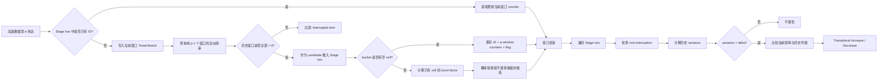

> **论文**：Resource-efficient Real-time Detection of Transitional Items in High-speed Data Streams  
> **作者**：Ang Hu, Guoju Gao, Yu-E Sun, He Huang, Yang Du  
> **核心方法**：ST-Sketch  
> **关键词**：Data Stream、Sketch、Transitional Item、Steady-to-Burst、TowerSketch、Real-time Detection  
> **阅读定位**：面向数据流测量 / 网络测量 / 边缘实时检测方向的技术解读  
> **外部信息核验日期**：2026-11-01

---

## 开头：发表信息、CCF 级别与开源情况

### 📌 发表信息

该论文已经被 **IEEE Transactions on Consumer Electronics（IEEE TCE）** 接收，论文首页明确标注：

- *accepted for publication in IEEE Transactions on Consumer Electronics*；
- DOI：**10.1109/TCE.2026.3746547**；
- 当前提供的 PDF 是 **author's version / accepted manuscript**，尚未完成最终排版，页眉中的卷号、期号仍是占位状态。

因此，更准确的说法是：**论文于 2026 年进入 IEEE Transactions on Consumer Electronics 的正式发表流程，并已经获得 DOI；当前版本尚不是最终卷期排版版。**

论文 DOI：<https://doi.org/10.1109/TCE.2026.3746547>

> 注意：PDF 版头中同时出现了 “VOL., NO., 2025” 的占位文字，但 DOI、版权信息和“accepted for publication”状态均指向 2026 年。因此不应把 2025 误解为最终正式出版年份。

### 🏷️ CCF 级别

截至 2026 年 CCF 发布的**第七版《中国计算机学会推荐国际学术会议和期刊目录》**，本次按期刊全名检索 **IEEE Transactions on Consumer Electronics**，未发现其被列入 A/B/C 推荐目录。因此：

> **CCF：未收录，无 A/B/C 等级。**

这和期刊本身的 JCR/Scopus 分区不是一回事。CCF 未收录并不意味着论文或期刊质量低，只代表它没有进入 CCF 当前这套计算机学科推荐目录。

CCF 官方目录入口：<https://www.ccf.org.cn/Academic_Evaluation/By_category/>

### 💻 是否开源

**论文正文没有提供 GitHub、项目主页或公开代码仓库。**截至本次检索，也没有发现作者公开的 ST-Sketch 官方实现，因此目前应视为：

> **代码未公开，至少论文中没有给出可复现的开源实现链接。**

不过，论文使用的若干实验数据源是公开或可申请获取的，包括 CAIDA、MAWI 和 Kaggle E-commerce 数据集。论文给出的数据源可用于自行复现实验框架。

---

# 1. 摘要 (Abstract) 与核心贡献 (Core Contribution)

## 一句话总结

> **ST-Sketch 用“第一阶段低成本筛选连续候选流 + 第二阶段显式维护多窗口频率轨迹”的两级 Sketch 结构，在很小内存和高吞吐约束下实时发现“此前长期稳定、随后突然爆发或骤降”的 transitional items。**

## 贡献列表 (Contribution List)

- **提出新的数据流模式 transitional item。**它不是简单寻找高频项或 burst item，而是要求一个 item 在连续多个时间窗口中先满足“不中断 + 稳定”，再在当前窗口发生显著的倍率突变，从而显式建模 **steady → burst** 的状态转移。

- **设计两阶段数据结构 ST-Sketch。**Stage one 使用多组 TowerSketch 保存不同时间窗口的近似频率并提前过滤发生过 interruption 的 item；Stage two 只为候选 item 保存 ID 和长度为 $p$ 的精细频率轨迹，再执行方差和 burst 检测，同时通过 burst-factor 驱动的概率替换机制保护更有价值的候选项。

- **针对空间与速度分别做专门优化。**空间上把 hot/cold item 分开，用不同位宽计数器适配数据流偏斜；速度上用 AVX2 SIMD 并行匹配 bucket 内的 ID，并用 segmented hashing 减少重复 hash 计算。

- **在四个真实数据集上验证资源效率。**论文在 100–400 KB 内存预算下比较 Precision、Recall、F1 和 Throughput。ST-Sketch 在任务匹配的基线和传统 burst 检测算法之间均表现出明显优势，优化版 ST-Sketch-Opt 进一步显著提高吞吐。

---

# 2. 引言 (Introduction)：问题背景与研究动机

## 2.1 问题定义 (Problem Definition)

传统数据流研究通常关注以下问题：

- frequency estimation：某个 item 出现了多少次；
- heavy hitter：哪些 item 非常频繁；
- heavy change / burst：哪些 item 在相邻时间段突然增长；
- steady item：哪些 item 在多个窗口中保持稳定。

这篇论文关心的是一个更细的时序模式：

> 一个 item 在前 $p-1$ 个时间窗口中**持续出现且频率稳定**，然后在第 $p$ 个窗口突然显著增加或减少。

作者把它称为 **transitional item（转移项 / 状态转移项）**。

假设滑动观察窗口为：

$$
w_t,w_{t+1},\ldots,w_{t+p-1},
$$

对应某个 item 的频率为：

$$
f_t,f_{t+1},\ldots,f_{t+p-1}.
$$

一个 transitional item 必须同时满足三件事：

1. **Non-interruption**：观察窗口内每个时间段都出现；
2. **Steadiness**：前 $p-1$ 个窗口的频率波动足够小；
3. **Burst**：第 $p$ 个窗口相对历史均值发生显著倍率变化。

这一定义比“突然变大”严格得多，因为它要求突变之前存在一个可信的稳定基线。

### 为什么重要？

作者给出的应用动机非常直观：

- **网络攻击**：攻击者可能先低频、稳定地扫描或探测，然后突然发起大量连接；
- **金融市场**：价格或交易频率经过一段窄幅稳定期后突然突破；
- **社交媒体**：一个话题在稳定低热度阶段后突然升温；
- **推荐系统**：某个商品不是长期热门，而是经历稳定状态后突然获得关注；
- **IoT / 智能家居**：低频探测 → 渗透 → 大规模控制，本质上也是状态转移。

因此，真正有价值的信息未必是“现在很大”，而可能是：

> **“它以前一直很稳定，为什么现在突然变了？”**

这就是本文的核心研究动机。

---

## 2.2 现有方法的局限 (Limitations of Prior Work)

### 局限一：传统 burst detection 只看“突增”，不看突增之前是否稳定

例如 BurstSketch、CM-PBE、TopicSketch 等方法主要关心事件频率是否突然增长，或者相邻时间段之间增长速度是否异常。

问题在于：

如果一个 item 本来就在剧烈波动，那么某个时间点再次变大，并不一定代表真正的“状态转折”。

例如：

$$
[10,100,20,90,150]
$$

最后的 $150$ 看起来很大，但这个序列从一开始就不稳定。

而：

$$
[10,12,9,13,60]
$$

最后的 $60$ 才更符合“由稳定状态进入突发状态”的含义。

因此，如果直接拿 burst detector 来解决 transitional-item detection，会产生大量 false positive。

### 局限二：只比较相邻窗口，看不到更长的状态演化

很多 burst 方法的核心统计量是：

$$
f_t \quad \text{vs.} \quad f_{t-1}.
$$

但“稳定”本身是一个多窗口概念。

要判断一个 item 是否真的处于 steady state，至少需要一个历史序列：

$$
[f_{t-p+1},\ldots,f_{t-1}].
$$

这也是 ST-Sketch 为什么必须显式维护 multi-window trajectory 的根本原因。

### 局限三：如果为每个 item 保存多窗口频率，内存会迅速爆炸

最直接的方法是：

```text
item ID -> [f1, f2, ..., fp]
```

但高基数数据流中可能有百万乃至千万个不同 ID。如果每个 item 都保存 ID 和 $p$ 个计数器，内存复杂度几乎等价于完整 hash table。

Sketch 可以压缩计数，但传统 sketch 又存在两个问题：

- 不保存 ID，难以直接报告具体 candidate；
- hash collision 会污染频率轨迹，尤其是多窗口统计。

所以论文真正面对的是一个三角矛盾：

> **多窗口历史信息、显式 item ID、极小内存预算**，三者很难同时满足。

---

## 2.3 本文思路 (Overall Idea)

作者的切入点可以概括成一句工程化的思想：

> **不要给所有 item 同样昂贵的跟踪待遇。**

ST-Sketch 把任务拆成两个阶段：

1. **Stage one：便宜地看所有 item。**  
   只做频率近似和 non-interruption 筛选，不保存每个 item 的完整 ID/轨迹。

2. **Stage two：昂贵地看少量候选 item。**  
   一旦一个 item 在连续窗口中都出现，就给它分配显式 cell，保存 ID 和多窗口频率，做精确的 steady + burst 判断。

这是一种典型的：

> **filter first, verify later（先粗筛，后精查）**

设计。

它把内存最昂贵的“ID + 多窗口 counters”资源集中给真正值得跟踪的候选项。

---

# 3. 方法论深度解析 (In-depth Methodological Analysis)

# 3.1 整体架构 (Overall Architecture)

论文 **Figure 1（p.5）** 是理解 ST-Sketch 的关键。

ST-Sketch 由两个阶段组成：

- **Stage one：$p$ 个轮转的 TowerSketch**；
- **Stage two：bucket-cell 哈希表结构**。

可以把整体流程简化为下面的 Markdown/Mermaid 图：



## 数据如何流动？

对于每个到来的 item $e$：

### 情况 A：它已经在 Stage two

说明它已经被认定为值得精细跟踪的 candidate。

此时无需再经过 Stage one，直接：

$$
C[w_t \bmod p] \leftarrow C[w_t \bmod p] + 1.
$$

也就是说，一旦进入 Stage two，它之后的窗口频率可以被**按 ID 精确计数**。

### 情况 B：它不在 Stage two

先写入当前窗口对应的 TowerSketch：

$$
T[w_t \bmod p].
$$

然后查询前 $p-1$ 个 TowerSketch，检查该 item 是否在历史窗口里都出现过。

若任意一个历史估计为 0：

> 认为它出现过 interruption，直接停止后续处理。

若所有历史窗口都大于 0：

> 它获得进入 Stage two 的资格。

### 窗口结束

ST-Sketch 遍历 Stage two 中的 candidate：

1. 连续性检查；
2. 计算历史方差；
3. 判断 steady；
4. 计算历史均值；
5. 与当前窗口比较；
6. 输出 increase / decrease transitional item。

### 架构的核心思想

宏观上，ST-Sketch 的重要变化并不是“换了一个更好的 Sketch”，而是：

> **把匿名的近似频率统计与显式的轨迹检测分离。**

Stage one 允许 collision 和近似，因为它只承担“候选生成”；Stage two 才承担最终模式判断。

这和只靠一个 Sketch 直接完成所有检测的思路有本质区别。

---

# 3.2 核心组件/模块拆解 (Core Component Breakdown)

## 3.2.1 Stage one：多窗口 TowerSketch 预过滤

论文在 Figure 1 中给出了 TowerSketch 的三层结构。

每个 TowerSketch $T[i]$ 包含：

- $A[0]$：$8w$ 个 **2-bit** counter；
- $A[1]$：$4w$ 个 **4-bit** counter；
- $A[2]$：$w$ 个 **16-bit** counter。

一个非常漂亮的细节是：三层总 bit 数实际上完全相同。

$$
8w\times2=16w,
$$

$$
4w\times4=16w,
$$

$$
w\times16=16w.
$$

所以每层都是 $16w$ bit，一个 TowerSketch 总计约为：

$$
48w\ \text{bits}.
$$

### Input & Output

**输入**：item ID $e$。  
**输出**：该 item 在某一个时间窗口中的近似频率。

### Internal Mechanism

每个 item 通过三个 hash 映射到三层 counter。

2-bit 层的最大正常计数很小，论文用值 3 表示 overflow；4-bit 层用 15 表示 overflow。查询时：

- 优先取映射 counter 中最小的有效值；
- 若最小值已经 overflow，则使用下一个未 overflow 的值。

直觉上，浅层提供大量窄 counter，适合绝大多数低频 item；深层用较少但更宽的 counter 承接高频 item。

### Design Rationale

高速度数据流通常高度 skewed：

> 大量 item 很冷，少数 item 很热。

如果所有 counter 都固定 16 bit，会把大量空间浪费在永远只计到 1、2、3 的冷流上。

TowerSketch 的“多数量小 counter + 少数量大 counter”让同一内存预算适应不同频率量级。

### 为什么 Stage one 需要 $p$ 个 TowerSketch？

因为作者按时间窗口做循环缓冲：

$$
T[0],T[1],\ldots,T[p-1].
$$

当前窗口使用：

$$
T[w_t \bmod p].
$$

进入下一个时间窗口后，最旧的 TowerSketch 被清空并复用。

本质上是一个固定长度为 $p$ 的 ring buffer。

---

## 3.2.2 Stage two：Bucket + Cell 的精细轨迹跟踪

Stage two 由 $n$ 个 bucket 构成，每个 bucket 包含 $q$ 个 cell。

一个 item 通过：

$$
g(e)\bmod n
$$

映射到一个 bucket。

每个 cell 保存：

$$
\langle ID,\ counters,\ flag\rangle.
$$

其中：

- `ID`：item 的显式标识；
- `counters`：长度为 $p$ 的频率数组；
- `flag`：标识 transitional increase / decrease。

### Input & Output

**输入**：通过 Stage one 连续性筛选的 candidate。  
**输出**：该 item 的精细多窗口轨迹，以及最终的 transitional-item 报告。

### Internal Mechanism

Stage two 最大的价值在于：

> **一旦 item 被纳入 candidate，后续更新不再依赖匿名 Sketch collision，而是直接按 ID 命中 cell 并精确累加。**

这使得后续 steady 判断中的方差、均值和 burst 比例更加可靠。

### 为什么不能把所有 item 都放 Stage two？

因为一个 cell 的成本明显高于一个 sketch counter。

粗略看，一个 cell 至少需要：

$$
\text{ID bits}+p\times\text{counter bits}+\text{flag bits}.
$$

$p$ 越大，单 item 的状态成本线性增加。

因此 Stage two 必须严格限制 candidate 数量。

---

## 3.2.3 Candidate Push 与概率替换机制

当 candidate 映射到的 bucket 还有空 cell 时，直接插入。

真正有趣的是：**bucket 已满怎么办？**

ST-Sketch 不使用简单 FIFO、随机替换或最小频率替换，而是定义一个 **burst factor**，衡量已有 item 当前窗口和历史均值之间的突变程度。

设历史均值为：

$$
\bar f=\frac{1}{p-1}\sum_{i=t}^{t+p-2}f_i.
$$

论文式 (5) 可以理解成：

$$
bf=
\begin{cases}
\dfrac{f_{t+p-1}}{\bar f}, & f_{t+p-1}>\bar f,\\[6pt]
\dfrac{\bar f}{f_{t+p-1}}, & f_{t+p-1}\leq\bar f.
\end{cases}
$$

因此 $bf$ 本质上是：

> **当前值和历史均值之间的对称倍率偏离程度。**

无论突然升高还是突然降低，只要偏离大，$bf$ 都会变大。

作者在一个满 bucket 中选择 **burst factor 最小** 的 cell 作为替换候选，因为它当前看起来最不像潜在 transitional item。

然后用：

$$
P=\frac{1}{bf+p}
$$

决定是否真的执行替换。

### 这个设计的直觉

- $bf$ 小：当前不够“突变”，优先成为牺牲者；
- $bf$ 大：更值得保护；
- $p$ 大：已经积累了更长历史，替换概率整体降低，防止轻易丢掉长期跟踪结果。

这是一个很典型的 **importance-aware eviction**。

### 批判性观察

该机制很实用，但更像经验性策略，而不是由某个最优性目标严格推导得到。论文没有给出：

- 替换概率对 recall 的理论下界；
- candidate survival probability；
- collision + replacement 联合造成的误差界。

因此这里是 ST-Sketch 工程上很聪明、理论上相对薄弱的地方。

---

## 3.2.4 Cold-start 与窗口轮转

论文 Algorithm 1 特别强调一个容易忽视的点：**最开始不能立刻检测。**

在前 $p$ 个窗口中，系统处于 cold-start：

- 只维护 Stage one；
- 不把 candidate 放进 Stage two；
- 等待积累足够历史信息。

原因非常合理：

如果连前 $p-1$ 个窗口都没有观察完整，就谈不上“steady → burst”。

代价是：

> 系统启动后的前 $p$ 个窗口存在不可避免的 detection blind period。

对于重启频繁的边缘设备，这个冷启动代价值得进一步研究。

---

## 3.2.5 两类优化：空间优化与速度优化

### A. 空间优化：hot/cold separation

论文指出，Stage two 如果所有 item 都使用 16-bit counter，依然会浪费大量空间。

因此进一步拆成：

- **light part / cold items**：8-bit counter；
- **heavy part / hot items**：16-bit counter。

当历史平均频率较小时，将 item 放入 light part，否则放 heavy part。

这相当于在 Stage two 再次利用数据分布的 skewness。

作者还提出：cold 和 hot item 对 burst 的敏感程度不同，可以设置不同 burst threshold。

这是合理的，因为：

$$
5\rightarrow15
$$

和

$$
100\rightarrow300
$$

虽然都是 3 倍，但业务意义未必相同。

> ⚠️ 一个文稿层面的细节：论文在这一段又使用 $\delta$ 描述冷热划分阈值，而前文 $\delta$ 已经表示 steadiness 的方差阈值。符号复用会造成一定歧义，正式实现时最好使用独立符号，例如 $\tau_{hot}$。

### B. 速度优化：AVX2 SIMD

论文 Algorithm 5 用 AVX2 一次比较 4 个 64-bit ID：

1. `_mm256_set1_epi64x(e)`：把目标 ID 广播成 4 份；
2. `_mm256_cmpeq_epi64`：同时与 4 个 cell ID 比较；
3. `_mm256_movemask_pd`：得到 4-bit mask；
4. `__builtin_ctz(mask)`：快速定位第一个命中位置。

这可以显著降低 bucket 内逐 cell 标量比较的成本。

### C. Segmented Hashing

原本 Stage one 三层需要三个 hash。

作者改成：

> 只生成一个 64-bit hash，再通过 bit shifting 把它切成多个片段。

Stage two 的 heavy/light part 也使用同一个 64-bit hash 的不同 32-bit 段。

其目的非常明确：

> **hash 本身也是高吞吐流处理中的显著 CPU 开销。**

---

# 3.3 关键公式与算法 (Key Equations and Algorithms)

## 3.3.1 Transitional item 的数学定义：论文最核心的公式组

论文 Section III 给出四个条件。

### 条件 1：Non-interruption

$$
f_i>0,\quad \forall i\in\{t,t+1,\ldots,t+p-1\}.
$$

#### Objective

保证 item 在整个观察周期都存在。

#### Intuition

如果一个 item 在中间消失过，再突然出现，它更像“reappearance”而不是从稳定状态自然转入 burst。

#### 值得注意的边界

该定义同时意味着：

> **如果最终窗口直接降到 0，它不属于 transitional decrease。**

因为 $f_{t+p-1}=0$ 会违反 non-interruption。

这在“连接突然完全消失”“传感器彻底停止上报”等场景中可能漏掉很重要的状态变化。

---

### 条件 2：Steadiness

论文使用前 $p-1$ 个窗口的方差：

$$
\frac{1}{p-1}
\sum_{i=t}^{t+p-2}
\left(
 f_i-
 \frac{1}{p-1}\sum_{j=t}^{t+p-2}f_j
\right)^2
\leq\delta.
$$

设：

$$
\mu=\frac{1}{p-1}\sum_{i=t}^{t+p-2}f_i,
$$

那么它就是：

$$
\sigma^2=\frac{1}{p-1}\sum_{i=t}^{t+p-2}(f_i-\mu)^2\leq\delta.
$$

#### Objective

判断 burst 发生之前是否真的存在稳定基线。

#### Meaning of Terms

- $p$：总检测窗口数；
- $p-1$：历史稳定阶段；
- $f_i$：第 $i$ 个窗口的频率；
- $\mu$：历史平均频率；
- $\sigma^2$：历史波动；
- $\delta$：允许的最大方差。

#### Intuition

如果历史自己都很乱，就不能把当前异常简单解释为“从 steady 状态发生 transition”。

#### 一个关键问题

这里采用的是**绝对方差**而不是归一化方差。

例如：

$$
[10,11,9,10]
$$

和

$$
[1000,1010,990,1000]
$$

相对波动程度近似，但后者绝对方差大得多。

因此固定 $\delta$ 会带来明显的 scale sensitivity。

更稳健的替代可以考虑：

- coefficient of variation：$\sigma/\mu$；
- normalized variance：$\sigma^2/\mu^2$；
- MAD（median absolute deviation）。

这是论文定义层面非常值得后续改进的地方。

---

### 条件 3：Transitional Increase

$$
f_{t+p-1}\geq
\lambda\cdot
\frac{1}{p-1}\sum_{i=t}^{t+p-2}f_i.
$$

即：

$$
f_{cur}\geq\lambda\mu.
$$

#### Objective

检测从 steady state 到突然增长。

#### Intuition

不是看绝对增加多少，而是看相对于历史正常水平放大多少倍。

这使 burst criterion 具有较好的 scale invariance。

---

### 条件 4：Transitional Decrease

$$
f_{t+p-1}\leq
\frac{1}{\lambda}
\cdot
\frac{1}{p-1}\sum_{i=t}^{t+p-2}f_i.
$$

即：

$$
\mu\geq\lambda f_{cur}.
$$

Increase 和 Decrease 因而是对称定义。

---

## 3.3.2 用论文 Figure 2 理解检测算法

论文 **Figure 2（p.8）** 给出了非常好的五类示例：

| Item | 历史/当前轨迹 | 结果 | 原因 |
|---|---|---|---|
| $e_1$ | `8, 7, 0, 20` | Interrupted | 历史存在 0 |
| $e_3$ | `5, 12, 30, 35` | Unsteady | 历史方差过大 |
| $e_5$ | `15, 17, 14, 75` | Transitional Increase | 历史稳定，当前大幅上升 |
| $e_2$ | `90, 87, 93, 15` | Transitional Decrease | 历史稳定，当前大幅下降 |
| $e_6$ | `70, 68, 66, 52` | Non-burst | 历史稳定，但当前变化不够大 |

这个图实际上把整篇论文的逻辑压缩成了三个连续的 gate：

```text
Gate 1: 有没有中断？
    ↓ 通过
Gate 2: 历史是否稳定？
    ↓ 通过
Gate 3: 当前是否达到倍率突变？
    ↓ 通过
Transitional Item
```

也就是说，ST-Sketch 的精髓不是一个复杂分类器，而是一条**非常明确的时序约束链**。

---

## 3.3.3 Algorithm 1–4 可以怎样理解？

论文给出了完整的插入、查询、检测和清理算法。

### Algorithm 1：Insertion

逻辑顺序是：

```text
先查 Stage two
→ 命中则直接精确 +1
→ 未命中则写 Stage one
→ 查询历史 p-1 个窗口
→ 若全部非 0，Push 到 Stage two
→ 满 bucket 时执行 burst-aware replacement
```

### Algorithm 2：Query

查询优先级：

```text
Stage two 精确值 > Stage one 近似值
```

如果 Stage two 找到 ID，就直接返回对应 counter；否则才查询 TowerSketch。

### Algorithm 3：Detection

窗口边界统一执行：

$$
\text{continuity}
\rightarrow
\text{variance}
\rightarrow
\text{mean}
\rightarrow
\text{burst ratio}.
$$

### Algorithm 4：Clearup

核心是环形窗口复用：

- 清空即将被复用的 TowerSketch；
- Stage two 中若当前窗口频率为 0，则整个 cell 清除；
- 否则只把下一位置 counter 置 0，为下一窗口留空间。

这保证了内存不会随时间增长。

---

# 4. 实验设计与结果分析 (Experimental Design and Results Analysis)

## 4.1 实验设置 (Experimental Setup)

### 计算平台

论文实验平台为：

- Intel **i7-13700**；
- 16 cores / 24 threads；
- base clock 2.10 GHz；
- 32 GB DRAM；
- 1.4 MB L1、24 MB L2、30 MB L3 cache；
- C++；
- g++ 13.1.0，开启优化；
- 64-bit BOB hash，不同随机 seed。

### 数据集

论文使用四个真实数据集：

1. **CAIDA2019**：匿名互联网流量，包含 DDoS、TCP/UDP probe 等；
2. **CAIDA2016**：取一分钟子集，共约 **30,265,265** 个 item；
3. **MAWI**：选取约 **20,000,000** 个 packet；
4. **E-commerce**：多类别线上商店行为数据，取 **30,000,000** 条记录。

### Ground Truth

作者用一个**精确 hash table**离线处理完整数据，对每个 item 得到真实多窗口频率；只有严格满足公式 (1)–(4) 的 item 才被标记为 ground truth transitional item。

这点非常重要，因为实验测量的是：

> **近似在线算法对作者数学定义的恢复能力。**

它并不等价于“这些 item 在现实语义上一定是攻击、异常或真正的市场拐点”。

### Metrics

- Precision Rate（PR）；
- Recall Rate（RR）；
- F1 Score；
- Throughput，单位 MPPS（million packets per second）。

### Baselines

由于此前没有专门针对 transitional item 的算法，作者构造和引入了多类对比：

- **TBS**：作者构造的两阶段 transitional baseline；
- **ST-Sketch-CM**：把 ST-Sketch Stage one 的 TowerSketch 换成 CM Sketch；
- **Strawman**：CM Sketch + hash table；
- **Strawman-Tower**：把 strawman 中 CM 换成 TowerSketch；
- **BurstSketch**；
- **TopicSketch**；
- **CM-PBE**；
- **ST-Sketch-Opt**：加入空间/速度优化的版本。

这里需要区分两类 baseline：

> TBS、Strawman、ST-Sketch-CM 等属于**任务匹配/结构对照**；BurstSketch、TopicSketch、CM-PBE 本来解决的是 burst 相关但不同的问题。

所以后者巨大的 F1 差距不能简单理解成“ST-Sketch 全面优于这些算法”，而应理解成：

> **普通 burst detector 不适合直接拿来做 steady-to-burst transition detection。**

论文自己也明确承认这一点。

---

## 4.2 参数实验：Figure 3–4

### Figure 3(a)：Stage one 内存占比 $r_1$

作者把 Stage one 的内存占比从 0.2 调到 0.9。

F1 呈现：

> **先升高，再下降。**

最佳点大约在：

$$
r_1=0.7.
$$

解释非常合理：

- Stage one 太小 → TowerSketch collision 严重，候选筛选错误；
- Stage one 太大 → Stage two 过小，candidate bucket collision / replacement 增多；
- 约 70% 给粗筛，30% 给精跟踪，形成较好平衡。

这直接验证了两阶段架构的核心假设：

> **粗筛和精查都需要资源，任何一侧被压得过小都会破坏整体性能。**

---

### Figure 3(b)：light part 内存占比 $r_2$

当 $r_2$ 从 0.1 增加到 0.6 时，F1 快速提升；之后逐渐进入平台。

作者推荐：

$$
r_2=0.6.
$$

这与数据流的 heavy-tail/skewed 特性一致：

> 冷 item 数量通常远多于热 item，因此 light part 应该获得更大容量。

---

### Figure 4(a)：每 bucket 的 cell 数 $q$

$q$ 从 1 增大到 8 时，F1 明显提高；8 以后改善很小。

原因：

- cell 太少 → bucket 内冲突严重；
- cell 增多 → candidate 更容易存活；
- 但 query/insert 都需要扫描 bucket，$q$ 太大降低吞吐。

作者最终建议：

$$
q=4.
$$

注意这里并不是追求最高 F1，而是在**准确率与速度之间折中**。

---

### Figure 4(b)：variance threshold $\delta$

$\delta$ 从 1 增加到 20 时，F1 只发生较小变化。

这说明在作者所用数据集和参数区间内，算法对 $\delta$ 相对不敏感。

但这里不能推出“$\delta$ 不重要”。

更准确地说：

> 在这些数据集上，只要 $\delta$ 位于一个合理区间，内存冲突、候选保留和 burst 判定可能比 steadiness 阈值本身更主导误差。

---

## 4.3 主实验结果：Figure 5–8

论文主实验不是一个单独的表格，而是 Figure 5–8 的四组曲线。

总内存预算：

$$
100\ \text{KB} \sim 400\ \text{KB}.
$$

每个数据集被划分为 **1000 个离散时间窗口**。

---

### Figure 5：Precision

当内存达到约 150 KB 时，ST-Sketch 的 Precision 已接近 1。

而 TopicSketch、CM-PBE、BurstSketch 在 transitional-item 任务上的 Precision 普遍较低。

这恰好验证作者最重要的动机：

> 如果只检测 burst，而不约束 burst 前的 steadiness，会报告大量“不是真正状态转移”的 item。

因此 Precision 的提升主要不是来自“计数更准一点”，而是来自**问题定义和检测条件更匹配**。

---

### Figure 6：Recall

ST-Sketch 在约 100 KB 内存时 Recall 已能超过 90%，150 KB 左右接近 1。

Recall 的主要敌人是：

- Stage one collision 导致错误候选；
- Stage two 空间不足导致候选被替换；
- 初始历史频率来自 TowerSketch 的近似估计；
- 高 cardinality 下真正的 transitional item 可能在成熟前被 eviction。

论文在讨论部分也指出：内存极小时，性能退化首先体现在 **Recall**，而 Precision 仍能保持较高。

这很好理解：

> 严格的方差 + burst gate 让“留下来的 item”不容易误报，但空间不足会让真正的 candidate 提前丢失。

---

### Figure 7：F1 Score

ST-Sketch 在四个数据集上总体表现最好。

论文正文给出的平均/汇总对比包括：

- 相比 ST-Sketch-CM：约 **1.55×**；
- 相比 Strawman：约 **2.69×**；
- 相比 Strawman-Tower：约 **1.14×**；
- 相比 TBS：约 **1.21×**；
- 相比 BurstSketch：约 **8.84×**；
- 相比 TopicSketch：约 **17.06×**；
- 相比 CM-PBE：约 **18.99×**。

这里最值得关注的并不是对 TopicSketch/CM-PBE 的十几倍优势，因为它们的任务定义不同。

更有解释力的是几个 controlled variants：

### ST-Sketch vs ST-Sketch-CM

只把 Stage one 的 TowerSketch 换成 CM Sketch，F1 就明显下降。

说明：

> **内存受限时，多位宽层次化计数对候选筛选准确率影响很大。**

### ST-Sketch vs Strawman-Tower

两者都使用 TowerSketch，但 ST-Sketch 仍更好。

说明收益不只是 TowerSketch 本身，还来自：

- bucket-cell candidate 管理；
- 显式 p-window trajectory；
- burst-factor-aware replacement；
- 更适合滑动检测的结构组织。

### ST-Sketch vs TBS

ST-Sketch 保留完整多窗口轨迹，而 TBS 更接近存 current count + historical mean。

ST-Sketch 更好，支持作者的核心判断：

> **只保存压缩后的历史统计量不足以充分表达状态转移，多窗口 trajectory 有实际价值。**

---

### Figure 8：Throughput

论文报告：

- ST-Sketch 相比 ST-Sketch-CM：约 **1.33×**；
- 相比 Strawman：约 **2.08×**；
- 相比 Strawman-Tower：约 **1.97×**；
- 相比 TBS：约 **1.80×**；
- 相比 TopicSketch：约 **6.05×**；
- 相比 CM-PBE：约 **7.18×**；
- **ST-Sketch-Opt 相比基础 ST-Sketch 吞吐提高约 59.33%**。

BurstSketch 的吞吐仍高于 ST-Sketch，这一点作者没有回避。

原因也很清楚：BurstSketch 的 update 更接近匿名计数器操作，而 ST-Sketch 需要：

- bucket ID matching；
- 维护 p-window trajectory；
- candidate replacement；
- 周期性 variance / mean 计算；
- cleanup。

所以 ST-Sketch 做的是一个典型 trade-off：

> **牺牲一部分极致吞吐，换取对更复杂时序模式的高准确识别。**

---

## 4.4 “消融实验”应该怎样读？

论文没有给出一个传统深度学习论文风格的 “remove module A/B/C” 表格，但实际上以下 variants 可以视为结构消融：

| 对照 | 控制变量 | 能说明什么 |
|---|---|---|
| ST-Sketch vs ST-Sketch-CM | Stage one: TowerSketch → CM | 分层计数对空间效率和 accuracy 的贡献 |
| Strawman vs Strawman-Tower | CM → TowerSketch | 单独测 TowerSketch 替换 CM 的收益 |
| ST-Sketch vs Strawman-Tower | 相同 Stage-one 思路，不同候选管理/检测结构 | 两阶段 bucket-cell 设计的贡献 |
| ST-Sketch vs TBS | 完整 trajectory vs 更压缩的历史摘要 | 多窗口轨迹对 steady-transition 判断的价值 |
| ST-Sketch-Opt vs ST-Sketch | hot/cold + SIMD + segmented hash | 优化主要提升吞吐，并在小内存下略改善 recall |

### 哪个部分对性能贡献最大？

如果只看**任务匹配、相对可控的 variants**，可以得到一个比较清晰的判断：

1. **TowerSketch 替代 CM Sketch 对 F1 的提升很明显**，说明内存预算下 Stage-one 频率估计质量非常关键；
2. **完整多窗口轨迹 + bucket candidate management** 带来第二层收益；
3. **SIMD / segmented hashing 的核心价值主要是 throughput，而不是改变检测定义。**

因此方法论上的主次应该是：

> **“两阶段 trajectory-aware detection”是算法灵魂；“TowerSketch”是空间效率关键；“SIMD/segmented hash”是工程加速器。**

---

## 4.5 具体实现细节

### 时间复杂度

论文给出的结论是：

- insert：$O(1)$；
- query：$O(q)$；
- detection：$O(nq)$。

但这个结论建立在作者显式假设：

> $p$ 和 $q$ 都被当作常数。

如果从参数化复杂度严格展开：

- 未命中 Stage two 后要查询 $p-1$ 个历史窗口；
- detection 需要对长度为 $p-1$ 的序列算均值和方差；

所以更严格的写法应接近：

$$
T_{insert}=O(q+p),
$$

$$
T_{detect}=O(npq).
$$

在实际部署中，如果 $p$ 为 4、8 这样的固定小常数，论文的 $O(1)$ / $O(nq)$ 表述是工程上成立的；但如果把 $p$ 当作可扩展参数，论文的复杂度表达略显乐观。

### 窗口大小与 latency

论文明确指出：检测只在每个 window 边界执行。

因此 reporting latency 的下界就是窗口长度 $\Delta T$。

- 小窗口：响应快，但 steady variance 更容易受 jitter 干扰；
- 大窗口：统计更稳定，但突发报告更慢。

这说明 ST-Sketch 并不是“逐 packet 立即报警”，而是：

> **packet-level online update + window-boundary detection。**

这个区别在真实系统部署中非常重要。

---

# 5. 讨论与思考 (Discussion and Reflection)

## 5.1 优点与创新点 (Strengths & Innovations)

### 🌟 优点一：问题定义本身有价值

论文最好的地方不是某个复杂数学技巧，而是把一个现实中常见但此前被混在 burst detection 里的模式明确抽象出来：

> **stable history + sudden transition**。

这个定义具有很强的解释性，非常适合安全告警、趋势转折等任务。

### 🌟 优点二：结构设计和数据分布高度匹配

ST-Sketch 没有试图用一个统一结构解决所有事情，而是合理地分层：

- 所有人先走便宜的 Stage one；
- 只有 candidate 才进入昂贵 Stage two；
- 冷/热 item 再使用不同 counter width。

这是一种非常“系统论文”的设计思维：

> 先看真实 workload 的 skewness，再决定怎样花每一个 bit。

### 🌟 优点三：检测逻辑可解释

相比复杂 ML detector，ST-Sketch 的每个判断都能解释：

- 为什么被过滤？——中间断过；
- 为什么不是 transition？——历史不稳定；
- 为什么报告？——当前达到历史均值的 $\lambda$ 倍。

这种可解释性对网络测量和在线监控系统很重要。

### 🌟 优点四：优化不是单纯“调代码”，而是围绕瓶颈设计

- counter bit-width 对应 memory bottleneck；
- SIMD 对应 bucket scan bottleneck；
- segmented hashing 对应 repeated hash bottleneck。

因此优化与系统剖析之间逻辑比较连贯。

---

## 5.2 局限性与可商榷之处 (Limitations & Debatable Points)

### ⚠️ 1. “真实应用”验证实际上仍是数学定义验证

Ground truth 是用精确 hash table 检查公式 (1)–(4) 得到的。

因此实验严格证明了：

> ST-Sketch 能否在有限内存下恢复“满足作者定义的 item”。

但它没有直接证明：

- 检出的 item 真的是 DDoS 攻击；
- 真的是金融市场转折；
- 真的是推荐系统中的爆款；
- 真的是 IoT 恶意控制。

如果想强化应用价值，应该再做一层**语义标签验证**。

例如在 CAIDA attack trace 上报告：

$$
\text{attack detection precision/recall}
$$

而不是只报告 transitional-pattern precision/recall。

---

### ⚠️ 2. 与 BurstSketch / TopicSketch / CM-PBE 的超大倍数优势需要谨慎解释

这些方法本来解决的目标就不同。

如果 baseline 的定义不要求 steadiness，那么它必然会把很多“burst 但历史不稳定”的 item 当正例，而在本文 ground truth 下这些都会算 false positive。

所以十几倍 F1 差距主要说明：

> **任务定义不匹配。**

真正最有说服力的结果应优先看：

- ST-Sketch-CM；
- Strawman / Strawman-Tower；
- TBS。

这些对照更能说明结构创新本身的价值。

---

### ⚠️ 3. 核心 steady 判据使用绝对方差，存在尺度依赖

如前所述：

$$
\sigma^2\leq\delta
$$

对不同频率量级并不公平。

hot flow 即使相对波动很小，也可能因为绝对数值大而产生较大方差。

论文后续虽然用 hot/cold separation 和不同 burst threshold 做补偿，但核心定义没有彻底解决 scale normalization。

我会优先尝试：

$$
\frac{\sigma}{\mu+\epsilon}<\tau
$$

或者 robust MAD。

---

### ⚠️ 4. 对极低频 item，倍率型 burst threshold 可能过于敏感

例如历史是：

$$
[1,1,1,1]
$$

当前是：

$$
5.
$$

那么 $\lambda=4$ 时已经被判定为 burst。

但从业务角度看，从 1 到 5 是否真的重要取决于场景。

作者通过 cold item 设置更高 burst threshold 来缓解，但这仍然是 heuristic。

更稳健的定义可以同时加入：

- relative change；
- absolute change；
- minimum support。

例如：

$$
f_{cur}\geq \lambda\mu
\quad\land\quad
f_{cur}-\mu\geq\gamma.
$$

---

### ⚠️ 5. Non-interruption 会排除“降到零”的重要突变

因为要求：

$$
f_i>0
$$

覆盖整个 $p$ 窗口，所以：

$$
[100,102,98,0]
$$

并不会被定义为 transitional decrease。

但现实中，“稳定运行 → 突然彻底停止”可能恰恰是最重要的异常之一。

因此未来可以把 transition 分类扩展为：

- steady → burst increase；
- steady → burst decrease；
- steady → disappearance；
- steady → oscillation；
- burst → steady。

---

### ⚠️ 6. 缺少 Sketch 误差和替换机制的理论 accuracy bound

论文有 time complexity theorem，但没有类似：

- frequency estimation error bound；
- false-positive probability；
- false-negative probability；
- Stage-two survival probability。

由于算法同时包含：

1. hash collision；
2. TowerSketch overflow；
3. probabilistic replacement；
4. multi-window thresholding；

如果能给出联合误差界，理论完整性会明显提高。

---

### ⚠️ 7. 边缘设备动机很强，但实验平台并不是边缘设备

论文多次强调：

- smart home hub；
- wearable；
- IoT gateway；
- resource-constrained edge device。

但最终实验使用的是 **Intel i7-13700 + 32 GB DRAM**。

这并不能直接证明其在：

- Raspberry Pi；
- ARM Cortex-A；
- ARM Cortex-M；
- 智能路由器 SoC；
- P4 switch / FPGA

上的真实吞吐、能耗和 cache behavior。

尤其是 ST-Sketch-Opt 使用 **AVX2**，而大量消费级边缘设备是 ARM 平台。

因此 59.33% 的 SIMD 加速收益并不能直接迁移到 ARM，需要改写为 NEON/SVE 或其他平台特定实现。

这是我认为论文工程外推中最明显的不足之一。

---

### ⚠️ 8. 部分关键复现参数没有被集中、完整地给出

论文对 $r_1,r_2,q,\delta$ 做了较充分讨论，但 $p$、不同数据集使用的 $\lambda$、hot/cold threshold 等配置没有形成一张非常清晰的 per-dataset parameter table。

再加上目前没有公开代码，使精确复现门槛变高。

---

### ⚠️ 9. 摘要中的“最高 7.36× F1 / 2.97× throughput”和 Section V 中的若干倍率并不直接对应

论文摘要/贡献部分强调约 **7.36× F1** 和 **2.97× throughput**，而 Section V 的正文又报告了相对 TopicSketch、CM-PBE 等更大的 F1/吞吐倍率。

这可能来自：

- 比较对象集合不同；
- 不同统计口径（平均值、特定 baseline、特定 memory）；
- 修订过程中摘要数字没有同步更新。

但论文没有在同一处明确解释这些数字如何对应。

因此阅读时应优先相信**具体 Figure 5–8 和对应正文上下文**，而不要只记摘要里的最大倍数。

---

## 5.3 未来工作与启发 (Future Work & Inspirations)

### 💡 方向一：从规则式 transition 扩展到“轨迹模式检测框架”

论文自己在 Discussion 中已经给出一个很好的方向：

Stage two 已经维护：

$$
[f_{t-p+1},\ldots,f_t].
$$

那么检测器其实可以替换。

例如：

- linear regression → 检测持续线性增长；
- 前后均值比较 → step change；
- 高方差 → oscillation；
- FFT / frequency-domain 特征 → periodic behavior。

也就是说，未来完全可以把 ST-Sketch 抽象成：

> **Sketch-based candidate generator + pluggable trajectory detector。**

这比只做 transitional item 更有研究潜力。

---

### 💡 方向二：自适应阈值，而不是手工 $\delta,\lambda$

现实数据流会 concept drift。

固定：

$$
\delta,\lambda
$$

很难长期适配。

可以让阈值根据：

- flow frequency level；
- 全局分位数；
- recent noise level；
- item-specific historical variance

自动调整。

例如：

$$
\lambda_e(t)=1+k\cdot CV_e(t).
$$

这样 burst threshold 可以和 item 自身的历史噪声水平绑定。

---

### 💡 方向三：用 robust statistics 替代均值 + 方差

均值和方差都容易受 outlier 影响。

如果前 $p-1$ 个窗口里已经有一个小异常，方差可能被放大，导致后续真正的 transition 被拒绝。

可以研究：

- median；
- MAD；
- trimmed mean；
- Huber estimator。

这样“steady”定义会更加稳健。

---

### 💡 方向四：端到端 edge deployment

如果我是作者，我会优先补一组：

- x86 AVX2；
- ARM NEON；
- Raspberry Pi / Jetson；
- 智能网关；
- FPGA / programmable switch

上的：

- MPPS；
- tail latency；
- energy per packet；
- cache miss；
- memory footprint。

这样“resource-efficient consumer electronics”这一主张会更加扎实。

---

### 💡 方向五：给出 probabilistic accuracy guarantee

ST-Sketch 很适合进一步做理论化。

例如研究：

> 在给定 memory $M$、stream cardinality $N$、skewness $\alpha$、窗口数 $p$ 时，真正 transitional item 被 Stage two 保留下来的概率是多少？

进一步可以推导：

$$
P(\text{miss})
\leq
P(\text{Stage1 error})
+
P(\text{eviction})
+
P(\text{threshold error}).
$$

这会让论文从“很强的系统设计”进一步升级成“理论与系统兼备”的工作。

---

## 5.4 对研究工作的直接启发

如果你正在做 **Sketch / network measurement / anomaly detection / streaming systems**，这篇论文有几个非常值得借鉴的研究套路：

1. **不要只卷经典任务的误差，而要重新定义更有语义价值的 pattern。**  
   “steady → burst”就是一个很好的例子。

2. **高基数流处理中，最重要的往往不是把所有 item 估得更准，而是决定哪些 item 值得花贵资源。**

3. **多阶段结构的价值来自职责分离。**  
   让概率结构负责 candidate generation，让显式结构负责 final verification，常常比强行让一个 sketch 完成所有任务更合理。

4. **工程优化应该针对真正的 hot path。**  
   ST-Sketch 的 SIMD 和 segmented hashing 都直接瞄准 update path 中的 ID scan/hash 开销，这比泛泛地“用多线程加速”更有说服力。

5. **设计 baseline 时要尽可能做 controlled comparison。**  
   本文最有价值的实验不是与不同任务的 burst detector 比十几倍，而是 ST-Sketch-CM、Strawman-Tower、TBS 这些能隔离变量的对照。

---

## 5.5 值得继续追问的几个问题

### 问题 1

如果把绝对方差 $\sigma^2$ 换成 coefficient of variation，hot/cold separation 还会带来同样大的收益吗？

### 问题 2

Stage two 的完整 $p$-window trajectory 是否真的必须全部存储？能否用可更新的 sufficient statistics（均值、二阶矩、斜率等）在不明显损失准确率的情况下进一步压缩？

### 问题 3

burst-factor replacement 是不是最优的 candidate eviction 规则？能否用“未来成为 transitional item 的概率”作为 learned / Bayesian replacement score？

### 问题 4

如果 stream 存在 concept drift，固定 $\delta$ 和 $\lambda$ 会如何退化？如何在线自适应而不引入大量状态？

### 问题 5

如果部署到 ARM/SmartNIC/P4 switch，ST-Sketch 的两级结构应该怎样重新设计，才能保持 SIMD/并行优势？

---

# 总结

这篇论文最值得记住的不是某一个 hash 技巧，而是下面这条完整逻辑链：

> **传统 burst detection 只看到“突然变了”，但真正有价值的转折往往是“之前很稳定，现在突然变了”。为了在高速流中捕捉这一状态转移，ST-Sketch 先用 TowerSketch 低成本筛掉不连续项，再把有限的显式 ID 和多窗口 counter 资源留给候选项，最终通过稳态方差与倍率 burst 条件完成检测。**

从研究视角看，它是一个很典型、也很值得学习的系统论文范式：

$$
\boxed{
\text{新问题定义}
\rightarrow
\text{针对 workload 的数据结构}
\rightarrow
\text{资源感知优化}
\rightarrow
\text{真实数据验证}
}
$$

它的强项是问题抽象、结构设计和系统优化；相对薄弱的地方是理论误差界、真实语义任务验证、参数复现完整性以及真正的 edge-device deployment。

如果后续研究能把 ST-Sketch 从“固定 steady-to-burst detector”发展成“可插拔的 compact trajectory-pattern framework”，并增加自适应统计、理论误差保证和跨硬件部署，我认为会比当前工作更有延展性。

---

## 原文定位速查

- **Abstract / Introduction**：p.1–3
- **Problem Statement / 定义公式 (1)–(4)**：p.4
- **Figure 1：ST-Sketch 数据结构**：p.5
- **Algorithm 1：Insertion**：p.5
- **Algorithm 2：Query / burst factor / replacement**：p.6
- **Algorithm 3–4：Detection / Clearup**：p.7
- **Figure 2：五类检测示例**：p.8
- **Algorithm 5：SIMD optimization / complexity discussion**：p.8
- **实验设置、Figure 3–4**：p.9–10
- **Figure 5–6：Precision / Recall**：p.10
- **Figure 7–8：F1 / Throughput**：p.11
- **Conclusion**：p.12
